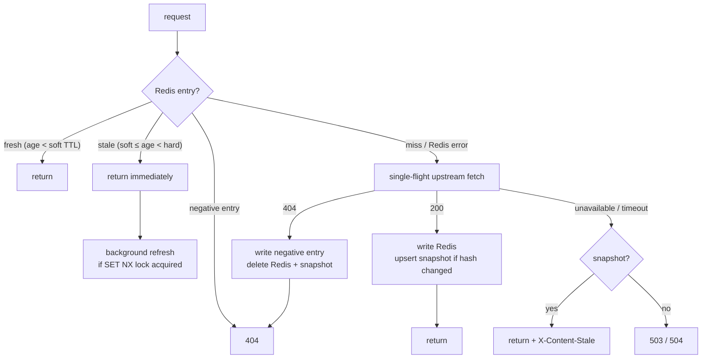

# Theory Content Service — Design Document

| | |
|---|---|
| **Service** | `fordona-boost-cms-bridge` (Python package `boost_bridge`) |
| **Phase** | 1 — content delivery only |
| **Tickets** | 01 (production-ready backend + design), 02 (expose Boost content) |
| **Status** | Implemented; upstream payload shapes **not yet verified** against a live Boost environment (see §12) |

---

## 1. Context

The Theory App needs a backend to serve its learning content. The content is written and published in **Boost**, Fordona's own CMS at `boost.fordona.io`, and organised in three levels:

```
module (theory module)  →  lesson (the app calls these "chapters")  →  question
```

This service reads published content from Boost and turns it into a stable API for the frontend.

Later, Damith's AI recommendation engine will decide what a learner sees next. This phase only leaves room for it to plug in; it implements none of it.

### Goals

- Expose all **published, learner-facing** Boost content: modules, lessons, questions, and pinned question revisions.
- Keep the API working when Boost is slow or briefly down.
- Give the frontend a typed API of its own, documented through OpenAPI, so it doesn't depend on Boost's internal shapes.
- Allow the recommendation engine to be added later without changing any route or response schema.

### Non-goals (Phase 1)

- Grading answers. Boost's delivery API omits answers on purpose, and grading needs a separate credential.
- Learner progress, attempts, subscriptions. These live in fordona-engine today.
- Any recommendation or personalisation logic.
- Editorial operations: drafts, imports, analytics, user management.

---

## 2. Which Boost API we consume

Boost exposes three API surfaces, each with its own credential:

| Surface | Paths | Credential | Contains answers? | Used? |
|---|---|---|---|---|
| Editorial | `/v1/questions`, `/v1/theory/*` | Kinde editor token / scoped API token | Yes, plus drafts | **No** |
| **Delivery** | `/v1/delivery/{modules,lessons,questions}[/{id}]`, `/v1/delivery/questions/{id}/revisions/{version}` | learner JWT **or trusted delivery service token** | No | **Yes** |
| Grading | `/v1/grading/questions/{id}/revisions/{version}` | grading credential | Yes | No (future) |

We call the Delivery surface using the **service token**, for two reasons:

1. **Caching.** Published content looks the same to every learner. Fetching it with one service credential means a single cache entry can serve every user. If we passed through each learner's token, the cache would have to be split per user, or we would risk the Delivery API treating different callers differently.
2. **Security.** Boost's own documentation warns never to put the service token in a browser or mobile app. A server-side bridge is exactly where it belongs.

**The consequence:** this service is now the access-control boundary for the content. §8 describes how it fills that role and where the gap remains.

---

## 3. Architecture

```mermaid
flowchart LR
    FE[Theory App] -- "Kinde JWT\nX-Correlation-ID" --> API

    subgraph bridge[boost_bridge]
        API[API routers\nvalidation · auth · locale] --> SVC[ContentService\nmapping · allowlist]
        SVC --> SEQ[ContentSequencer\n(extension point)]
        SVC --> CC[ContentCache\nread-through · SWR · single-flight]
        CC --> R[(Redis\nhot cache)]
        CC --> BC[BoostClient\nasync httpx · retries]
        CC --> PG[(Postgres\nlast-known-good snapshot)]
    end

    BC -- "service token" --> BOOST[Boost Delivery API]
    FE -. "asset URLs (public)" .-> ASSETS[Boost /assets/{id}]
```

### Layers

| Layer | Package | Responsibility | Must not |
|---|---|---|---|
| API | `api/routes`, `api/deps.py` | Parse HTTP, validate input, resolve learner and locale, call the service, return a schema | Contain business logic, or talk to Boost or storage directly |
| Service | `services/content_service.py`, `services/mappers.py` | Use cases; turn upstream models into API schemas through an explicit allowlist | Know about HTTP |
| Cache / refresh | `services/content_cache.py` | Read-through Redis → Boost → Postgres fallback, stale-while-revalidate, single-flight | Map shapes, or know about resources |
| CMS client | `clients/boost` | Typed async calls to Boost, timeouts, retries, error classification | Cache anything |
| Persistence | `db/` | Store and read snapshots | Contain business logic |
| Cache store | `cache/` | Fail-open Redis wrapper, envelope encoding, distributed lock | Raise on a Redis failure |
| Schemas | `schemas/` | The frontend contract (Pydantic) | Use upstream field names that we haven't chosen deliberately |
| Core | `core/` | Config, logging, correlation, errors, auth, locale, clock | — |

Dependencies point **downward only**: routes → service → cache → (client, repository, redis). The client and the storage adapters never import anything from the service layer or above.

---

## 4. API contract

All content routes require `Authorization: Bearer <Kinde access token>`. FastAPI generates the full OpenAPI document at `/openapi.json`, with interactive docs at `/docs`. Every operation has a stable `operationId` so the frontend can generate a client from it.

| Method | Path | Boost upstream |
|---|---|---|
| GET | `/v1/modules?page&pageSize&slug` | `GET /v1/delivery/modules` |
| GET | `/v1/modules/{moduleId}` | `GET /v1/delivery/modules/{id}` |
| GET | `/v1/modules/{moduleId}/lessons?page&pageSize` | `GET /v1/delivery/lessons?moduleId=` |
| GET | `/v1/lessons?moduleId&slug&page&pageSize` | `GET /v1/delivery/lessons` |
| GET | `/v1/lessons/{lessonId}` | `GET /v1/delivery/lessons/{id}` |
| GET | `/v1/lessons/{lessonId}/questions?page&pageSize` | `GET /v1/delivery/questions?lessonId=` → sequencer |
| GET | `/v1/questions?moduleId&lessonId&ids&page&pageSize` | `GET /v1/delivery/questions` |
| GET | `/v1/questions/{questionId}` | `GET /v1/delivery/questions/{id}` |
| GET | `/v1/questions/{questionId}/revisions/{version}` | `GET /v1/delivery/questions/{id}/revisions/{version}` |
| GET | `/health/live` | — (no auth) |
| GET | `/health/ready` | — (no auth) |

### Conventions

- **IDs are decimal strings** (`^[1-9][0-9]*$`), the same format Boost uses. They are never converted to numbers, because a 64-bit ID can lose precision in JavaScript. Malformed IDs are rejected with a 422 at our own boundary and never reach Boost.
- **Pagination** uses `page ≥ 1` and `1 ≤ pageSize ≤ 100`, defaulting to 20. List responses have the shape `{items, total, page, pageSize, asOf}`.
- **Locale** is resolved in this order:
  1. the `?locale=` query parameter (`en-GB` or `sv-SE`);
  2. the `Accept-Language` header, matched on its primary subtag (`en*` → `en-GB`, `sv*` → `sv-SE`);
  3. the default `sv-SE`, matching fordona-engine.

  The resolved locale is echoed in the `Content-Language` response header.
- **No locale fallback.** Boost serves each locale exactly as requested and never substitutes another, and we mirror that. Every entity carries `availableLocales` so the client can choose. If the product wants to fall back to Swedish automatically, that is a deliberate change to make here (see §12).
- **Assets** are returned as absolute URLs (`{BOOST_PUBLIC_BASE_URL}/assets/{assetId}`), which Boost serves publicly and immutably. We never proxy asset bytes through Python.
- **Stale responses** carry the `X-Content-Stale: true` header. This happens when the service is answering from the Postgres snapshot because Boost is unavailable.

### Response allowlist

The response schemas name every field they expose; nothing from upstream is passed through blindly. In particular:

- **Questions never include `correctOptionId` or `explanation`**, even if Boost were to start sending them. The mapper ignores these fields, and a test guards against them leaking.
- **`aiContextSummary`** is lesson metadata intended for the AI engine. It is kept in the snapshot but not exposed to the frontend.
- **`contentHtml`** is passed through unchanged, because Boost is a trusted, editor-controlled source. If Boost ever accepts untrusted authors, the HTML must be sanitised here or in the client.

### Errors

Every error is returned as an RFC 7807 `application/problem+json` body, using the same shape as fordona-engine:

```json
{
  "type": "https://fordona.io/errors/content/not-found",
  "title": "Content Not Found",
  "status": 404,
  "detail": "The requested content does not exist or is not published.",
  "instance": "/v1/questions/42",
  "errorCode": "CONTENT_NOT_FOUND",
  "correlationId": "c3f4a1b2-…"
}
```

| Situation | Status | `errorCode` |
|---|---|---|
| Missing, invalid or expired token | 401 | `UNAUTHORIZED` |
| Bad path, query or pagination input | 422 | `VALIDATION_FAILED` (with `fieldErrors`) |
| Content not found or unpublished | 404 | `CONTENT_NOT_FOUND` |
| Boost rejected *our* credential or request | 502 | `UPSTREAM_MISCONFIGURED` |
| Boost unavailable and no snapshot exists | 503 | `UPSTREAM_UNAVAILABLE` |
| Boost timed out and no snapshot exists | 504 | `UPSTREAM_TIMEOUT` |
| Anything unexpected | 500 | `INTERNAL_ERROR` (no stack trace in the body) |

When Boost returns 401 or 403, the service answers **502, not 401**. The learner's credentials were fine; it was our service token that Boost rejected. Reporting it as an auth error would send the frontend into a re-login loop and hide a configuration fault. These failures are logged at ERROR level.

---

## 5. Cache and refresh strategy

### Why two storage tiers

| Tier | Role | What happens if it is lost |
|---|---|---|
| **Redis** | Hot cache shared by every replica. It decides freshness and holds the refresh lock. | Requests go straight to Boost. Latency rises, but correctness is unaffected (fail-open). |
| **Postgres** `content_snapshot` | Durable copy of the last successful response for each request key. Used only when Boost fails. | We lose the ability to serve during a Boost outage. |

Using Redis alone would turn any Boost outage that coincides with a cold or flushed Redis into an outage of our own. The snapshot table costs one upsert per *change* in content, not one per request.

### Cache key

```
bridge:v1:{resource}:{locale}:{sha1(sorted query params + path ids)}
```

The `v1` prefix is the schema version of what we cache. Bumping it invalidates everything on deploy without a manual flush.

### Read path



**Thresholds** (all configurable):

- Soft TTL: 300 s.
- Hard TTL: 24 h. This is the Redis `EX`.
- Negative TTL: 30 s.

**Mechanics:**

- **Stale-while-revalidate.** A stale entry is served at cache-hit latency while one background task refreshes it.
  - **Across replicas**, refreshes are deduplicated with a Redis `SET NX PX` lock that has a short expiry.
  - **Within a process**, a set of in-flight keys does the same job.
  - Background tasks are tracked and cancelled on shutdown, so the event loop never loses references to them.
- **Single-flight on a miss.** When many requests miss the same key at once in one process, they share one upstream call (an in-flight future map). Without this, a cold start or a key expiring would fan out one Boost request per waiting learner. We do not coordinate misses across replicas; the worst case is one upstream call per replica, which we accept.
- **Stale-if-error.** The snapshot is used **only** when Boost is unavailable or times out. It is never used for a 404.
- **Unpublish semantics.** When Boost returns 404, we delete both the Redis entry and the snapshot. Without that, content that has been withdrawn would come back through the fallback the next time Boost blips.
- **Fail-open Redis.** Every Redis operation has a 0.5 s socket timeout. A Redis failure is logged at WARN and treated as a miss; it never becomes a 500.
- **We cache the raw upstream payload**, not the mapped response. It is mapped to response schemas on every read. That way the answer allowlist also covers cached and stale data, and a mapper fix takes effect immediately without flushing anything.

### Freshness after publishing

Boost exposes no publish webhook. **Newly published or edited content therefore becomes visible within one soft TTL (5 minutes by default).** Unpublished content can survive in Redis for up to the soft TTL plus one refresh. If editors need instant publishing, the fix is a Boost webhook that calls a purge endpoint here. That endpoint is deliberately not built in Phase 1.

---

## 6. CMS client

- **Connection reuse.** One `httpx.AsyncClient` is created in the application lifespan and closed on shutdown.
  - Connection pool: `max_connections=100`, `max_keepalive_connections=20`.
  - Timeouts: `connect=2s, read=5s, write=5s, pool=2s`.
- **Retries** apply to GET requests only, since every call we make is idempotent.
  - They are triggered by connect errors, timeouts, and status codes 429, 502, 503 and 504.
  - At most 2 retries, with exponential backoff and full jitter. `Retry-After` is honoured, capped at 2 s.
  - The whole call, retries included, is bounded by an **8 s budget**. A learner never waits for an unbounded retry chain.
- **Error classification** maps each Boost failure to one of four exceptions: `BoostNotFound`, `BoostMisconfigured`, `BoostUnavailable` and `BoostTimeout`. The `requestId` from Boost's problem body is logged, so incidents can be traced across both services.
- **Correlation.** The incoming `X-Correlation-ID` is forwarded to Boost.
- **Typed models.** Upstream payloads are parsed into Pydantic models with `extra="ignore"`. When Boost adds a field, nothing breaks; when Boost renames one, the change is confined to `clients/boost/models.py` and `services/mappers.py`.

---

## 7. Data model

```sql
CREATE TABLE content_snapshot (
    cache_key     TEXT        PRIMARY KEY,
    resource      TEXT        NOT NULL,   -- e.g. module, module_list, question
    locale        TEXT        NOT NULL,
    payload       JSONB       NOT NULL,   -- raw upstream response
    content_hash  CHAR(64)    NOT NULL,   -- sha256 of canonical JSON
    fetched_at    TIMESTAMPTZ NOT NULL
);
CREATE INDEX ix_content_snapshot_resource_locale ON content_snapshot (resource, locale);
```

- **Writes** use `INSERT … ON CONFLICT (cache_key) DO UPDATE … WHERE content_snapshot.content_hash <> EXCLUDED.content_hash`. A refresh that finds unchanged content costs no write and adds no table bloat.
- **Migrations** live in `migrations/` (Alembic, async environment). They run as a **pre-deploy step** (`alembic upgrade head`) and never at app startup, because replicas starting together would otherwise race to migrate.

---

## 8. Authentication and trust model

- **Token verification.** Callers present a Kinde access token. It is verified against the same Kinde tenant fordona-engine uses:
  - The signature must be **RS256 only**. `HS256` and `none` are rejected, which closes off algorithm-confusion attacks.
  - `iss` must equal `KINDE_ISSUER_URI`.
  - `aud` must contain one of `KINDE_AUDIENCE`.
  - `exp` and `nbf` are checked with 30 s of leeway.
- **JWKS handling.** The JWKS is fetched asynchronously and cached for 10 minutes. A token with an unknown `kid` triggers one refetch, rate-limited to once every 60 s, so made-up `kid` values cannot be used to hammer Kinde.
- **Learner principal.** Each verified request produces a `Learner(sub, claims)` principal, which is logged as `sub`.
- **Local development.** `AUTH_ENABLED=false` exists for local work only. The service **refuses to start** with it in any `APP_ENV` other than `local`.
- **Secrets** (`BOOST_DELIVERY_TOKEN`) are held as `SecretStr` and are never logged. Logs also redact `Authorization` headers.

### Known gap: entitlement

> In Phase 1 **any signed-in Kinde user can read the entire published question bank.** fordona-engine currently restricts theory content by subscription (`LearnAccessLevel`, `GET /v1/theory/access`). This service has no such check yet. It must be closed **before public launch**, in one of two ways:
> (a) an entitlement claim in the Kinde token, verified locally; this is cheapest and preferred.
> (b) a cached call to fordona-engine's access endpoint.
> The `Learner` principal is already resolved on every request, so either option is a dependency added in `api/deps.py`; no route changes are needed.

---

## 9. Observability

- **Structured logs** via structlog: JSON in deployed environments, a console renderer locally.
- **Correlation ID.** Every log line carries `correlation_id`. It is read from `X-Correlation-ID`, the header fordona-engine uses, or generated if absent. It is echoed on the response and forwarded to Boost.
- **One access-log line per request** records method, path, status, duration and the learner `sub`. Uvicorn's own access log is turned off to avoid duplicates.
- **Pure ASGI middleware.** The correlation and logging middleware is written as plain ASGI rather than Starlette's `BaseHTTPMiddleware`, which interferes with contextvars propagation and with background tasks.
- **Cache events** are logged at DEBUG (hit, miss, stale) and at WARN (fallback served, Redis error). These lines are the hooks for future metrics.
- **Health probes:**
  - `/health/live` always returns 200, as long as the process can serve HTTP.
  - `/health/ready` runs Postgres `SELECT 1` and Redis `PING` in parallel, each with a 1 s timeout. It returns 503 if either fails, and the body reports the status of each component.
  - **Boost is deliberately excluded from readiness.** We can serve snapshots during a Boost outage, and pulling every replica out of rotation because a dependency is down would only make that outage worse.

---

## 10. Configuration and deployment

All configuration is read from environment variables through `pydantic-settings` (`core/config.py`); `.env.example` documents each one.

**Deployment** follows the same pattern as fordona-engine: **Railway + Docker**.

- The image is multi-stage. Dependencies are installed with `uv sync --frozen`, and the process runs as a non-root user.
- There is one uvicorn worker per container. To scale, add replicas.
- **Railway pre-deploy command:** `alembic upgrade head`.
- **Probes:** liveness → `/health/live`, readiness/healthcheck → `/health/ready`.
- **Dependency pinning.** `uv.lock` is the only dependency lockfile. There is deliberately no `requirements.txt`, because a second pinned list would drift from the lockfile. If a platform ever needs one, generate it with `uv export`.

---

## 11. Extension points for the recommendation engine

These are interfaces only. Nothing in them is implemented.

1. **`ContentSequencer`** (`services/sequencing.py`)
   ```python
   class ContentSequencer(Protocol):
       async def sequence(self, learner: Learner, questions: list[Question],
                          context: SequencingContext) -> list[Question]: ...
   ```
   - The default `CmsOrderSequencer` returns its input unchanged, preserving CMS order.
   - It is provided by `get_sequencer` in `api/deps.py` and applied on `/v1/lessons/{id}/questions`.
   - Damith's engine becomes a second implementation, chosen in `get_sequencer`. The route, the response schema and the frontend do not change.
   - The engine can reorder, filter or select a subset.
2. **Learner identity**: `Learner.sub` is available on every request. The engine can key learner state on it without a schema change.
3. **Content copy**: `content_snapshot` holds every payload the service has served.
   - It is keyed per request, not per entity, so it is a convenience rather than a full catalogue.
   - If the engine needs the complete bank, the next step is a **per-entity sync job** that pages through `/v1/delivery/*` into normalised tables.

---

## 12. Risks and open questions

| # | Risk / question | Impact | Owner / next step |
|---|---|---|---|
| 1 | **No subscription/entitlement gate** (§8) | Paid content readable by any signed-in user | Ashen — choose claim vs. engine call before launch |
| 2 | **Delivery response shapes are untyped in Boost's OpenAPI** (`type: object`). Our models are inferred from the `Entity` and `*Mutation` schemas | Mapping may be wrong until checked against real payloads | Obtain delivery service token + staging URL; capture one real payload of each type; tighten `clients/boost/models.py` |
| 3 | **Overlap with fordona-engine `learn`.** It serves theory content from Directus and stores progress and attempts keyed by Directus UUIDs | Moving the frontend to Boost IDs (decimal strings) leaves existing progress pointing at nothing | Ashen — decide migration path and who owns progress and grading |
| 4 | **Kinde audience** for Theory App tokens unknown | Valid tokens rejected, or a too-broad audience accepted | Confirm the audience value |
| 5 | **Readiness includes Redis**, as required, but Redis is fail-open | A Redis blip removes every replica from rotation even though the service still works | Revisit after first incident; option: report Redis as degraded with a 200 |
| 6 | **Up to soft-TTL staleness after publish** (no webhook) | Editors wait up to 5 minutes | Boost publish webhook → purge endpoint, if needed |
| 7 | **Order of delivery lists** is not specified by Boost. Its editorial order endpoints are editor-only | Lesson/question order might not match editorial order | Confirm delivery lists honour editorial order |
| 8 | **Locale fallback** (§4) | Missing translations show as missing | Product decision |
| 9 | **No rate limiting** in this service | Scraping by an authenticated user | Add per-`sub` limiting alongside the entitlement work |
