# Fordona Theory: First-Shipment Architecture

**Lesson theory and question templates from Boost, with rich media (text, images, GIFs, animations, video, audio),
served through the BFF; per-attempt tracking; and a forced retry phase straight after every lesson (wrong questions +
2–5 similar questions from the whole question bank)**

| | |
|---|---|
| Document | `fordona-theory-first-shipment-architecture.md` |
| Revision | **5**. Adds the Boost content API contract we define (§13), the Boost stub as a facade over today's Boost (§4.5), the home screen, learning path, streak, daily challenge and readiness APIs (§5.7, §7.3), and the build and hand-off list (§14). Replaces revisions 1 (threshold-triggered review) and 2 (engine-imported content bundle). |
| Status | Design for team review. No implementation. |
| Date | 2026-10-30 |
| Scope | The first shipment only. The three-level adaptive design (`fordona-theory-platform-architecture.md`, `fordona-level2-rules-algorithm-design.md`) is a **future direction, not a requirement here**. |
| Design reference | `Main-Home-Page.png`, **without** 1.6 "Repeat what you learned so far" for this release; `Lesson_Simple_Question.png` (theory screen, question, feedback sheets) |

> **Terminology.**
> - **Unit:** the app's unit (Boost `module`).
> - **Lesson:** the app's lesson (the spec's "chapter").
> - **Question template:** a named group of questions in one lesson, with mixed difficulties. A lesson has one or
>   more templates. Example: lesson 1.2 "How to indicate" has a template of 8 questions and another of 10.
> - **Question bank:** every published question in every template.
> - **Lesson theory:** the content a learner reads, watches or listens to before the quiz (the "Sign Language" screen
>   with **Start Quiz**).
> - **Content blocks:** the one format used for theory, question prompts, options and feedback: text, image,
>   animation (incl. GIFs), video, audio (incl. podcasts), rule card.
> - **Lesson phase:** one template's questions.
> - **Retry phase:** the forced follow-up: the lesson phase's wrong questions plus similar questions from the bank.

---

## 0. What changed

| Area | Earlier revisions | Now (revision 4) |
|---|---|---|
| Real content (Eric) | Imported into the engine as a bundle | **Authored and published in Boost**. Boost is the content system of record. |
| Dummy content | Imported into the engine as a demo bundle | Served by a **Boost stub**: a small service with Boost's exact API, used only in dev and staging (§4.5) |
| Who serves templates and question text to the app | The engine | **The BFF**, from Boost (or the stub), cached by immutable revision (PA DD-07 restored) |
| What the engine holds | Text, options, keys, tags | Structure, tags, **answer keys and explanations** only. No question text. |
| Question roles | `LESSON` / `RESERVE` inside a template | **None.** A template is just a group of questions. |
| Source of similar questions | Reserve questions only | **The whole question bank**, filtered by the rules in §5.3 |
| Which questions a lesson attempt uses | All LESSON questions of all templates | **One template per attempt** (§5.2, O-2) |
| "Repeat what you learned so far" (1.6) | An authored lesson | **Removed** for this release. The unit path, attempts and ledger are shaped so it can be added later without breaking the app (§11). |
| Template choice | Template 1, rotating on retakes | A swappable `QuestionSetSelector`; first attempts hash-spread across templates (§5.2) |
| Lesson theory | Not modelled | A **theory section** per lesson, shown before the quiz on every attempt, served by the BFF from Boost (§4.6, §7.3) |
| Rich media | Questions had an optional `media` image | Theory, prompts, options and feedback all use one **block format**: text, image, animation, video, audio, rule card. Media streams **from a CDN straight to the app**, never through the BFF or engine (§4.6, §9.5). |
| Feedback content | Plain `explanation` text | Explanation **blocks** (incl. rule cards). The correct option's label and content are filled in by the server, never authored by hand. |
| Boost's template API | "To be agreed with the Boost owner" | **We define it** (§13), as additive extensions of Boost's existing `/v1/delivery` and `/v1/grading` conventions. The Boost owner implements §13 as written. |
| Boost stub | Fully synthetic fixtures | A **facade over today's Boost** that serves the §13 contract: real modules, lessons and questions, generated templates, a change feed and batch endpoints. Separate deployable in the BFF repo (§4.5). |
| Lesson theory source | A new Boost theory entity | **The Boost lesson itself** (it already has `contentHtml`, `resources`, `estimatedReadMinutes`). §13 adds `blocks`; until Boost has them, the stub converts the HTML. |
| Home screen and unit sheet | Not designed | `GET /v1/home` (one call for the whole dashboard) and `GET /v1/learning-path` (every unit and lesson, with ETag/304) (§7.3) |
| Streak, weekly activity, daily challenge, readiness | Not designed | Defined and stored per learner, written in the lesson-completion transaction (§5.7) |
| `GET /v1/units`, `GET /v1/units/{unitId}` | Two calls per sheet | **Replaced** by `GET /v1/learning-path` |

---

## 1. Decisions at a glance

| # | Decision | Recommendation | Why |
|---|---|---|---|
| 1 | Who owns lesson order, template choice, grading and the retry phase | **fordona-engine.** It returns question *references*; the app renders what the BFF composes. | Every rule reads the learner's history across devices. One implementation for iOS, Android and web; no app release for a rule change. |
| 2 | Content system of record | **Boost**, for structure, templates, question text and answer keys | Eric authors there; one place to edit and publish |
| 3 | Who serves templates and question text | **The BFF**, hydrating the engine's references from Boost's delivery API and caching by `(questionId, version, locale)` | Agreed boundary (PA DD-07). The engine never sends text; the BFF never sees an answer key. |
| 4 | Dummy content | A **Boost stub** that implements Boost's delivery and grading endpoints over fixture files. The BFF and the engine point `BOOST_BASE_URL` at it in dev/staging. | Both services use their real Boost clients, unchanged. Switching to Eric's content is a URL and token change, not code. |
| 5 | The retry phase | **Forced** when the lesson phase has ≥ 1 wrong answer. Every wrong question again (options re-shuffled) + E similar questions. **One phase only**; the lesson then completes, whatever the score. | Matches the journey in the brief. Bounded by construction. |
| 6 | How many similar questions | `E = clamp(ceil(1.5 × W), 2, 5)`, W = wrong answers in the lesson phase. W = 0 → no retry phase. | Reproduces the brief's example (2 wrong → 3 extras), stays in 2–5, configurable |
| 7 | Where similar questions come from | The **whole bank**, through a precomputed neighbour list per question, filtered per learner: not in this attempt, same or one lower difficulty level, **unit entitled to this learner**, unseen first, and (by default) not from a lesson the learner hasn't reached | The brief's "entire bank", without leaking paid units or spoiling future lessons |
| 8 | Similarity mechanism | Neighbour lists computed **when content changes**, not per request. Metadata strategy now; the AI lead's vector service fills the same lists later. The engine stores no vectors. | Similarity is a property of content. Precomputing it keeps the AI service off the learner's request path. |
| 9 | Hot-path performance | Engine: content metadata, keys and neighbours in an **in-memory snapshot**. BFF: question bodies in **Redis** by immutable revision. Postgres is touched only for the learner's own rows. | No content queries and no Boost calls per request; no cross-learner lock contention; stateless, horizontally scalable services |
| 10 | Lesson unlocking | **Sequential**: lesson n+1 unlocks when lesson n is completed, including its retry phase. The first lesson of unit u+1 unlocks when the last visible lesson of unit u is completed **and** unit u+1 is entitled; otherwise the app shows **Upgrade to Continue**. Completed lessons can be retaken. | Makes "forced" meaningful (O-4) |
| 11 | Readiness for a future "Repeat…" entry | The unit path is a list of **typed entries** (`kind`), attempts have a `kind`, the mistake ledger is recorded from day one, and the app must ignore entry kinds it doesn't know | Adding the review later is an engine release, not a breaking app change (§11) |
| 12 | Template choice per attempt | A **`QuestionSetSelector` port**. This release ships a fixed, non-personalized rule: the first attempt's template is assigned by a stable hash of (learner, lesson), and retakes rotate (§5.2). Every attempt records which strategy chose its questions. | Templates exist to enable personalized question sets later. That needs real behaviour data, and the data is only useful if every template is served to comparable learners (§12 O-2). |
| 13 | Lesson theory | **The Boost lesson's own content** (one revision per lesson). Served by the **BFF** in `GET /v1/lessons/{lessonId}` together with the engine's lock, status and question-count preview. The engine stores only the lesson **revision id** an attempt was started from. | Theory is pure content: no grading, no learner logic. It reuses the question bodies' path and cache. |
| 14 | One rich-content format | A **block list** for theory, prompts, options and explanations. Blocks carry **asset ids, not URLs**; the BFF turns ids into CDN URLs per response. | One renderer in the app, one validation rule set, one cache rule. A new media type is a new block type, which is additive. |
| 15 | Media delivery | **CDN straight to the app.** Images in responsive WebP/AVIF variants; GIFs converted to looping video; animations as Lottie; video and audio as HLS. Paid-unit media behind **short-lived signed URLs**, signed when the response is built. | Media is almost all of the bytes. Proxying it would make the BFF the bottleneck; permanent public URLs would leak paid content. |
| 16 | Boost content API | **Fordona defines it** (§13): template endpoints, a change feed, batch revision reads, `topicKey`, content blocks. Additive to Boost's existing `/v1` API, same conventions. | The template API doesn't exist yet, and whoever defines it decides our sync cost and hot-path latency. Defining it ourselves lets us design for scale (cursor change feed, batch reads, immutable caching) instead of adapting to whatever ships. |
| 17 | Boost stub | A **separate service in the BFF repo** (`src/boost_stub/`, own Docker target, own Dokploy app in dev/staging only). It implements §13 over today's Boost. | One contract, two implementations: the stub now, Boost later. Our services only ever speak §13. |
| 18 | Home and learning path | **One call per screen.** `GET /v1/home` for the dashboard; `GET /v1/learning-path` for the swipe-up sheet, with ETag/304 so an unchanged sheet costs one primary-key read. Both answered by **one** engine call each. | The mobile developer's request; one round trip per screen on mobile networks; no BFF fan-out |
| 19 | Streak, challenge, readiness | Computed from per-learner rows written in the **same transaction** as lesson completion, in the learner's own timezone (§5.7) | Always consistent with progress, O(1) to read, no batch jobs, no cross-learner contention |

---

## 2. Learner journey

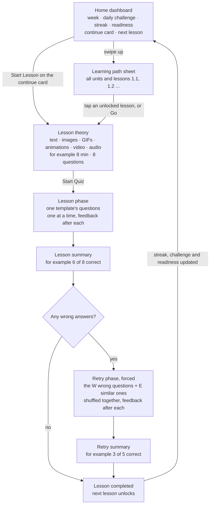

| Step | Rule |
|---|---|
| Home | One call (`GET /v1/home`). The continue card shows the lesson with an open attempt (**Continue**), otherwise the next unlocked lesson (**Start Lesson**), otherwise the next lesson of a unit the learner isn't entitled to (**Upgrade to Continue**). |
| Learning path sheet | One call (`GET /v1/learning-path`), revalidated with ETag, so reopening an unchanged sheet returns 304. The current lesson shows **Go**. |
| Lesson theory | Shown before the quiz on **every** attempt, including retakes. Not graded. Watching a video or playing audio is not required to start (O-9). **Start Quiz** creates the attempt. With an open attempt, the button reads **Continue** and resumes it. The progress dots shown on the theory screen in the design are part of the lesson header, not a quiz item. |
| Lesson phase | Every question in the template must be answered. There is no skip; completing with an unanswered item is refused. |
| Summary | Shows correct / total. Its only action is **Continue**, which leads into the retry phase when W > 0. |
| Retry phase | Cannot be skipped. If the app is closed, reopening the lesson **resumes the retry phase**. |
| After the retry phase | The lesson is completed regardless of the retry score. Wrong answers stay recorded; nothing blocks progress. |
| Tracking | Every answer in both phases is stored with its question's domain, topic, difficulty and level as they were when it was served. |

---

## 3. Components and responsibilities

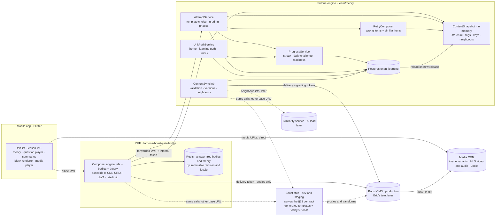

| Component | Owns | Never does |
|---|---|---|
| **Mobile app** | Rendering content blocks; playing media straight from the CDN; prefetching the attempt's images while theory is shown; sending answers with client-generated ids; resuming an open attempt; ignoring unknown entry kinds **and unknown block types** | Ordering, grading, choosing questions, seeing a correct answer before answering |
| **BFF** | The public contract; JWT check; rate limiting; **hydrating the engine's question references with bodies from Boost**; **lesson theory**; turning asset ids into (signed) CDN URLs; the body and theory cache | Holding learner state, grading, choosing questions, seeing answer keys, carrying media bytes |
| **fordona-engine** | Content read model (structure, tags, keys, explanations), template choice, attempts, grading, the retry phase, the mistake ledger, neighbour lists, retry policy | Serving question text, theory or media; storing vectors; calling Boost or the similarity service on a learner request |
| **Boost** | Authoring, publishing, immutable revisions of theory and questions, templates, answer keys, media assets and their processing (O-10) | Learner data |
| **Media CDN** | Caching and serving media bytes; verifying signed URLs | Deciding access (the BFF signs) |
| **Boost stub** | Serving the §13 contract in dev and staging: generated templates, a change feed and batch reads of its own; modules, lessons, questions and grading proxied from today's Boost and transformed to §13 shapes | Running in production; being imported by the BFF app |
| **Similarity service** (later) | Embeddings, the vector index, top-k neighbour lists per question revision | Grading, retry rules, learner data, request-time calls |

**Why the split between the BFF and the engine holds:**
- **Answer keys stay in the engine:** they arrive over its own grading token and leave only inside feedback, after
  an answer.
- **Text stays out of the engine:** the BFF already has the Boost client and a revision cache.
- **Text and key can't disagree:** the engine pins `(questionId, version)` per item. The BFF fetches exactly that
  revision. Boost revisions are immutable, so the text shown and the key used to grade are always the same revision.

---

## 4. Content model and question-ingestion pipeline

### 4.1 Content model

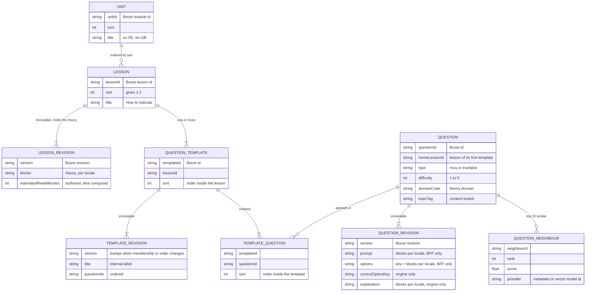

- **The theory is the lesson's own content.** Boost lessons already carry `contentHtml`, `resources` and
  `estimatedReadMinutes`; §13 adds `blocks`. An attempt records the lesson revision that was current when it started,
  so later analysis can tell which theory a learner had seen.
- **A template is an ordered group of questions.** Example: lesson 1.2 "How to indicate" has template A (8 questions)
  and template B (10 questions). There are no roles: every question is a normal bank question.
- **A question may sit in more than one template** (the join `TEMPLATE_QUESTION` allows it). Its **home lesson** is
  the lesson of its first template by sort; that is what similarity scoping and spoiler checks use.
- **Tags drive tracking and similarity:**

| Tag | Meaning | Values |
|---|---|---|
| `domainCode` | Theory domain | Boost's subject taxonomy (6 codes) |
| `topicTag` | Content the question tests | A controlled vocabulary per unit, e.g. `indicating.roundabout-exit` |
| `difficulty` | Authored difficulty | 1–5, mapped to a **level** by config: 1–2 easy, 3 medium, 4–5 hard |

### 4.2 What Boost must provide (O-1)

Boost implements the **content API contract in §13**, which we define. In summary:

| Addition | Why |
|---|---|
| Question templates: list per lesson, immutable revisions | The unit of lesson content |
| `topicKey` on questions, and a topic vocabulary per module | Tracking and similarity |
| `blocks` on lessons (theory), question prompts, options and explanations; asset types image, animation, video, audio with captions and transcripts | Rich content (§4.6) |
| A cursor-based **change feed** | Incremental sync. An idle poll costs Boost one indexed read. |
| **Batch revision reads** (delivery and grading, up to 100 refs) | One call instead of up to 13 on a cold cache; a full sync in seconds |
| A lesson revision endpoint | Theory becomes immutable and cacheable like questions |
| Cache headers: `immutable` on revisions, `ETag` on lists | Caching at the BFF and any CDN in front of Boost |

**Everything is additive.** Existing endpoints and fields keep working, so the current web app is unaffected. Until
Boost ships §13, the stub (§4.5) serves it.

### 4.3 Pipeline

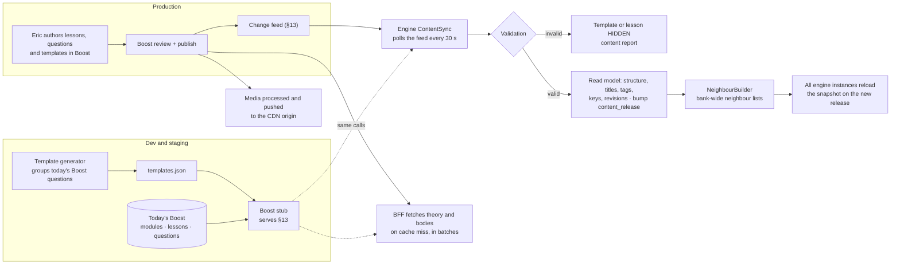

**Sync mechanics:**
- The engine stores the last change-feed cursor in `content_release`. It polls every 30 s, applies changes, and fetches
  new revisions with the batch endpoints.
- A full resync (cursor reset) is a platform action, used after a source switch.
- No change means no new release, so instances don't rebuild their snapshot.

### 4.4 Validation (engine sync)

| Level | Rule | On failure |
|---|---|---|
| Question | Revision has a key among its options; options distinct; difficulty 1–5; domain and topic known; both locales present | Question **excluded** (not served, not a neighbour) |
| Template | ≥ 3 valid questions | Template **HIDDEN** (never chosen for an attempt) |
| Lesson | ≥ 1 visible template, and non-empty theory content | Lesson **HIDDEN**; unlocking skips past it |
| Media (Boost publish, O-10) | Alt text, captions and transcripts present; asset processing finished | Publish blocked in Boost; the engine never sees it |
| Similarity coverage | For each question at level L: ≥ 2 neighbours at level L or L−1 in the same or an earlier lesson | **Report only.** The retry phase serves fewer extras (§5.3, step 5). |

The report (`GET /v1/platform/theory/content-report`) is what Eric and the content owner check after each publish.

### 4.5 The Boost stub (dev and staging)

**What it is:** a small FastAPI service that serves the **§13 contract on top of today's Boost**. The engine and the
BFF point at it in dev and staging and at Boost in production, and can't tell the difference.

**Where it lives:** in the BFF repo, isolated from the BFF app.

| Item | Value |
|---|---|
| Code | `src/boost_stub/`, its own package. The BFF app never imports it; an import-linter rule in CI enforces this. |
| Data | `stub-data/templates.json` (generated); `stub-data/synthetic.json` (demo questions for thin lessons); sample media in a dev R2 bucket |
| Build | Its own Dockerfile target (`docker build --target boost-stub`). The BFF's production image does not contain it. |
| Deploy | Its own Dokploy app, dev and staging only, on the private network |

**What each §13 endpoint does in the stub:**

| §13 endpoint | Stub behaviour |
|---|---|
| `question-templates` (list, revision) | Served from `templates.json` |
| `changes` | Maintained by the stub. Every 60 s it lists today's Boost (modules, lessons, questions) and compares versions with its last snapshot (a small SQLite file). Each difference, and each new template generation, becomes a change row with an increasing `seq`. |
| `modules`, `lessons` (+ revision) | Proxied to Boost. `contentHtml` + `resources` are converted to `blocks` (a supported HTML subset; anything else is dropped and logged). |
| `questions` (+ revision, + batch) | Proxied. `questionText` + `mediaId` become `prompt` blocks; options become option blocks; `topicKey` is injected as `lesson-{lessonId}` (a placeholder until Eric's topics). Batch reads fan out in parallel to Boost's single-revision endpoint and are cached in memory, since revisions are immutable. |
| `grading` (single, batch) | Proxied with the caller's grading token; explanation text is converted to blocks |
| Anything for a synthetic question (ids ≥ 9,000,000) | Served from `synthetic.json`, including grading |

**Auth:**
- The stub forwards the caller's bearer token to Boost **unchanged**, so token scopes stay real: the BFF's delivery
  token can't read grading through the stub any more than through Boost.
- It adds `X-Boost-Stub: true` to every response. The engine refuses to start with the `prod` profile if it sees
  that header.

**The template generator** (`scripts/generate_stub_templates.py`, run by hand, output committed):
1. Read published modules, lessons and questions from today's Boost.
2. Per lesson, sort the questions by (difficulty, id) and deal them round-robin into `k = max(1, floor(n / 8))`
   templates, so every template gets the same difficulty mix (R-7). The remainder is spread one per template.
3. Lessons with fewer than 3 real questions get synthetic `[DEMO]` questions from `synthetic.json`, up to 8.
4. Template ids come from a reserved range (≥ 9,000,000). The output carries a `generation` number, and any change
   bumps the `version` of every affected template.

It is deterministic: two runs on the same Boost data produce the same file.

**The swap to Eric's content:**
1. Boost ships §13.
2. Eric authors his content in Boost.
3. Staging config points `BOOST_BASE_URL` (BFF) and `theory.boost.base-url` (engine) at Boost.
4. Trigger `POST /v1/platform/theory/content-sync?full=true`.
5. Reset staging learner data, because the stub's template ids no longer exist.

Production never points at the stub, and the swap needs no code change.

**Contract tests:**
- One suite in the BFF repo exercises every §13 endpoint.
- It runs against the stub in CI, and against Boost staging once Boost implements §13.
- Passing on Boost staging is the acceptance test for the Boost owner's work.

### 4.6 Rich content: blocks and media

Theory, question prompts, options and explanations all use **one block format**: an ordered list of typed blocks per
locale.

| Block | Fields | Delivered to the app as | Allowed in |
|---|---|---|---|
| `text` | `markdown`: a restricted subset (paragraphs, bold, italic, lists, links), sanitised | Inline | Theory, prompt (required, first), option, explanation |
| `image` | `assetId`, `alt` (required), `width`, `height`, `caption?` | CDN URL, responsive WebP/AVIF variants (e.g. 480/960/1440 px) | Theory, prompt, **option** (e.g. a road sign), explanation |
| `animation` | `assetId`, `format` (`lottie` or `video_loop`), `alt` (required) | Lottie JSON, or a muted looping MP4 | Theory, prompt, explanation |
| `video` | `assetId`, `posterAssetId`, `durationSec`, `captions` (WebVTT per locale, required) | HLS, adaptive bitrate | Theory, prompt, explanation |
| `audio` | `assetId`, `durationSec`, `transcript` (required) | HLS or AAC, streamed | Theory (podcasts), prompt |
| `rule_card` | `kind` (`RULE` or `SIGN`), `title`, `points[]`, optional `image` | Inline | Theory, explanation (the "Right-Hand Right of Way · RULE" card in the design) |

**Rules:**
- **GIFs are accepted from authors but never delivered.** They are converted on ingest to an `animation` with
  `format: video_loop`, which is typically 5–10× smaller and decodes in hardware on phones.
- **Blocks carry asset ids, never URLs.** Cached JSON stays valid when the CDN host or signing key changes. The BFF
  turns every `assetId` into a URL when it builds a response.
- **Media never passes through the BFF or the engine.** The app fetches it from the CDN directly, with HTTP range
  requests for audio and video.
- **Access control:** media of a unit that isn't free is served through **signed URLs** (path + expiry, TTL 2 h),
  signed per response, so the cache never holds a signed URL. Free-unit media may use plain, long-cached URLs. If a
  signed URL expires mid-lesson, the CDN returns 403; the app re-fetches the lesson or attempt (`GET`), which re-signs.
- **Accessibility is enforced at publish:** alt text on every image and animation, captions on every video, a
  transcript on every audio. Missing ones block publishing in Boost (O-10). The stub's fixtures follow the same rules.
- **Graceful rendering:**
  - an unknown block type is skipped by the app (the same forward-compatibility rule as unknown entry kinds);
  - an asset that can't be resolved is dropped from the response by the BFF and logged, never shown as a broken
    screen.
- **The correct-answer line is generated, not authored.** The design's "So the right answer in this case would be C,
  'Vehicles coming from your right'" contradicts its own highlighted option. Feedback therefore returns
  `correctOption { key, label, content }` built from the served option, and the app renders the sentence from it.
  Explanations must not restate the answer letter.

---

## 5. Lesson attempt and the forced retry phase

### 5.1 Attempt lifecycle

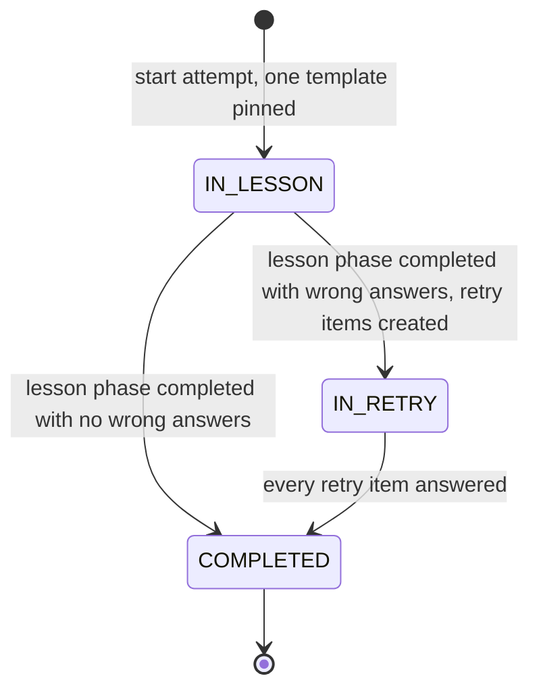

| Transition | Guard (checked before any write) |
|---|---|
| start | Unit entitled; lesson visible and unlocked for this learner; no open attempt on this lesson (an open one is **resumed**) |
| complete lesson phase | Status `IN_LESSON`; every lesson item answered |
| complete retry phase | Status `IN_RETRY`; every retry item answered |
| answer an item | The item belongs to the current phase and is unanswered (a same-option replay is accepted) |

An open attempt waits until the learner returns; the lesson shows `in_progress`. Completing a phase that is already
complete returns the stored summary (natural idempotency).

### 5.2 Which questions an attempt uses (O-2)

Templates exist so that, in a later release, each learner can get a **personalized question set**. That can't be
designed until real learners' behaviour is known. So this release makes the choice **swappable and measurable**, but
not personalized.

**The port:**
```java
interface QuestionSetSelector {
    // Pure: no I/O. Reads the content snapshot and the learner's prior attempts on this lesson.
    QuestionSetSelection select(SelectionContext ctx);
}
// QuestionSetSelection = ordered (questionId, version, templateId) refs + strategy id + reason
```

The output is a **list of questions, not a template id**. A future selector can mix questions from several templates
or from the bank, with no change to attempts, items, grading or the API.

**First-release implementation: `FixedTemplateSelector` (strategy id `fixed-v1`).** It ignores performance data
entirely:
- **First attempt:** template index = `hash(app_user_id, lesson_id) mod visibleTemplates`. This is stable (the same
  learner always gets the same template, on every device) and spreads learners evenly across templates.
- **Retakes:** the next visible template in `sort` order, wrapping around. Attempt k uses
  `(firstIndex + k − 1) mod visibleTemplates`.
- **Pinning:** the selected refs (question + revision + template) are pinned on the attempt. A template edited
  mid-attempt changes nothing for that attempt.

**Why hash-spread and not "template 1 for everyone":**
- If everyone's first attempt uses template 1, the first release produces behaviour data on template 1 only, and
  retake data on the others from a self-selected group: the learners who retake.
- Spreading first attempts evenly gives **comparable, unbiased data on every template and every question**:
  - real difficulty per question;
  - which topics cause wrong answers;
  - how long questions take.

  That is exactly what a personalization design needs as input.
- It is still not personalized: the choice depends on identity only, never on behaviour.

**What is recorded for the future personalization design:**
- `lesson_attempt.selection_strategy` and `selection_reason` (e.g. `fixed-v1`, `first:hash`, `retake:rotate`);
- `attempt_item.template_id` on every lesson item;
- the full per-answer record in §5.4.

A future strategy can be rolled out per unit or per cohort by config (`theory.selection.strategy`) and compared
against `fixed-v1` on the same metrics.

### 5.3 Composition of the retry phase

Built **inside the "complete lesson phase" transaction**. The response carries the summary and the retry items,
already hydrated by the BFF, so they are on the device before the learner taps Continue.

1. **Repeat items:** every wrong lesson item, at the **same pinned revision**, with the option order **re-shuffled**.
2. **Similar items:** `E = clamp(ceil(extras_per_wrong × W), extras_min, extras_max)`, defaults 1.5 / 2 / 5.

   | W (wrong in lesson phase) | 0 | 1 | 2 | 3 | 4+ |
   |---|---|---|---|---|---|
   | E (similar questions) | no retry phase | 2 | 3 | 5 | 5 |
   | Retry phase size (W + E) | — | 3 | 5 | 8 | W + 5 |

3. **Picking the similar items.** Seeds are the wrong items in `seq` order. Pick **round-robin**: one candidate per
   seed per pass, until E are picked or every list is exhausted. For each seed, walk its neighbour list (§8) in rank
   order and take the first candidate that passes every filter:

   | # | Filter | Why |
   |---|---|---|
   | a | Not excluded by validation, and its lesson is visible | Never serve broken content |
   | b | Level in `{L, L−1}`, L = the seed's level, floor easy | "Same or one lower difficulty" |
   | c | Not already in this attempt (lesson or retry items) | "New" questions only |
   | d | **Its unit is entitled to this learner** (the same rule that locks units) | A free learner must never receive a paid unit's questions through a retry |
   | e | `similar_scope` (default `REACHED`): its home lesson is completed or is this lesson. `ALL` allows the whole bank. | Stops questions from lessons the learner hasn't reached appearing early (O-5) |
   | f | **Unseen first:** the walk runs twice, first excluding questions this learner has ever answered (one indexed query per retry phase), then allowing them | Prefer genuinely new questions |

4. **Order:** repeat and similar items are shuffled together with a seed derived from the attempt id, then stored. The
   learner can't tell which are new, and a resume shows the same order.
5. **Fewer candidates than E:** the phase is served with what passed, down to repeats only. It never fails, and the
   shortfall is stored on the attempt (`retry_extras_short`) for the content report.

In practice the top neighbours of a question are the **other templates of the same lesson** (same topic), so with
`REACHED` the filter (e) rarely removes anything and the bank-wide pool is still used.

### 5.4 What is recorded per answer

Each `attempt_item` row stores:
- `phase` (`LESSON` / `RETRY`) and `item_source` (`TEMPLATE`, `REPEAT`, `SIMILAR`);
- `template_id` for template items, `origin_question_id` for similar items (the seed);
- a snapshot of `domain_code`, `topic_tag`, `difficulty`, `level` at serve time;
- `provider` and `similarity_score` for similar items;
- `selected_option_key`, `is_correct`, `duration_ms`, `answered_at`.

Totals are written once per phase: `lesson_total / lesson_correct / lesson_wrong` and
`retry_total / retry_correct / retry_wrong`.

The attempt also stores `lesson_version`: the lesson revision (holding the theory) that was current when **Start Quiz** created it.
Media engagement (whether a video was watched, how much of a podcast was played) is **not tracked in this release**.
If it is wanted later, it arrives as client events, not as a change to these tables.

### 5.5 Mistake ledger (recorded now, read by the future review)

One row per learner × question ever answered wrong.

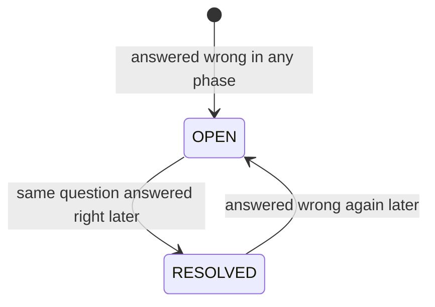

`resolved_via` records how it was resolved:
- `REPEAT`: in the retry phase, straight after being shown the answer.
- `RETAKE`: on a later attempt of the lesson.
- `LATER`: anywhere else, e.g. as a similar item in another lesson.

A future review can then decide not to trust `REPEAT` (see R-1).

### 5.6 Retry policy

| Key | Default | Range | Scope |
|---|---|---|---|
| `retry_enabled` | true | — | GLOBAL / UNIT / LESSON |
| `extras_per_wrong` | 1.5 | 0.5–3.0 | GLOBAL / UNIT / LESSON |
| `extras_min` / `extras_max` | 2 / 5 | 0–5 / 1–10, min ≤ max | GLOBAL / UNIT / LESSON |
| `level_drop_allowed` | 1 | 0–2 | GLOBAL / UNIT / LESSON |
| `similar_scope` | `REACHED` | `REACHED` or `ALL` | GLOBAL / UNIT |
| `difficulty_level_map` | `{1: easy, 2: easy, 3: medium, 4: hard, 5: hard}` | — | GLOBAL |

- LESSON overrides UNIT, which overrides GLOBAL.
- The resolved values are **snapshotted onto the attempt at start**, so a change never alters an attempt in progress.
- Edited through `PUT /v1/platform/theory/retry-policy/{scope}/{scopeId}`. The edit bumps the content release, so
  every instance applies it within 30 s (§9.2).
- There is **no rounds setting**: one retry phase is the rule. `attempt_item.phase` leaves room for more later.

### 5.7 Progress: streak, weekly activity, daily challenge, readiness

These drive the home screen. They are computed from a few per-learner rows that are written **in the same
transaction as lesson completion**. They are therefore always consistent with progress, cost O(1) to read, and need
no batch jobs.

**Definitions** (O-11 and O-12 for product sign-off):

| Metric | Definition |
|---|---|
| Lesson completed | The attempt reaches `COMPLETED`: after the retry phase, or after the lesson phase when W = 0. Retakes count as activity. |
| Active day | A **local** day, in the learner's timezone, with at least one lesson completed |
| Weekly activity | The 7 days of the current local week, each `done`, `today` (with `done` if already active), `missed` or `upcoming`. Week start is config `week_starts_on`; the design shows Sunday first. |
| Streak | Consecutive active days ending **today or yesterday**. If the last active day is older, the streak shown is 0. `extendedToday` = today is already active. |
| Daily challenge | "Complete N lessons" today, N = `daily_challenge_lessons` (default 3). Progress = **distinct** lessons completed today: completing the same lesson twice counts once, so the challenge can't be farmed. Resets at local midnight. |
| Readiness | `round(100 × Σ best_accuracy(lesson) / visible lessons)`. `best_accuracy` is the best lesson-phase `correct / total` over completed attempts; a lesson not yet completed counts 0. It rewards both coverage and quality, and only goes up for a learner unless new lessons are published. |

**Timezone:**
- The app sends the device's IANA timezone in `X-Timezone` on every request.
- The engine stores it on the learner's summary row when it changes. Invalid values are ignored; the default is
  `Europe/Stockholm`.
- The local date is computed at write time. Changing timezone can't double-count a day:
  `learner_activity_lesson` is keyed `(learner, local_date, lesson)`.

**Write path.** Steps 1–4 run inside the lesson-completion transaction, on the learner's own rows:
1. `lesson_attempt` → `COMPLETED`.
2. `lesson_progress` upsert: `COMPLETED`; `best_accuracy = GREATEST(old, new)`; `first_completed_at` on the first
   completion.
3. `INSERT learner_activity_lesson … ON CONFLICT DO NOTHING`. If a row was inserted, upsert `learner_activity_day`
   with `lessons_completed + 1`.
4. Update `learner_theory_summary`:
   - **streak:** unchanged if `last_active_date` is today; `+ 1` if it is yesterday; otherwise reset to 1. Then
     update `longest_streak` and `last_active_date`;
   - `sum_best_accuracy += delta`;
   - `completed_lessons + 1` on a first completion;
   - `progress_version + 1`.

Starting an attempt also bumps `progress_version`, because the learning path shows open attempts.

**Read path:**
- **Home:**
  - one primary-key read of the summary;
  - one range read of at most 7 activity days;
  - one index scan of the learner's `lesson_progress` (≤ ~200 rows);
  - plus the in-memory snapshot and the cached entitlement.

  Three small queries, no joins across learners.
- **Learning path:** the ETag is
  `"{release_id}.{progress_version}.{entitlement_hash}.{locale}"`. A matching `If-None-Match` returns 304 after one
  primary-key read. Otherwise there is one more index scan.

Completion responses (§7.3) return the updated progress, so the app can refresh the streak and challenge without
calling home again.

---

## 6. Data model (engine, schema `engn_learning`)

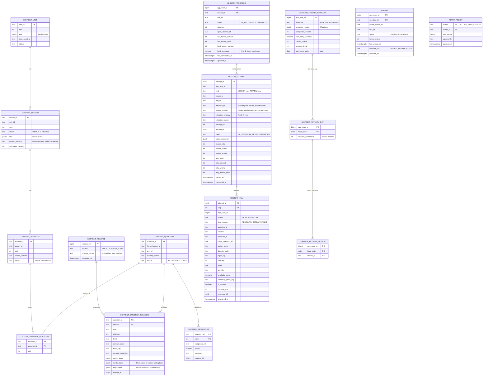

**No question text in the engine:**
- `option_keys` (e.g. `["a","b","c","d"]`) is enough to validate an answer and to shuffle.
- `explanation` (content blocks, including rule cards) is stored because Boost's grading route returns it with the
  key, and feedback is sent from the engine after grading. It holds **asset ids only**: the BFF resolves them to CDN
  URLs on the way out, exactly as for bodies.
- Theory content is not stored at all; only `content_lesson.current_version`, titles and `estimated_minutes`. Unit and lesson **titles** are stored
  (small display text the home screen and learning path need); question text and theory are not.

**Constraints and indexes:**

| Constraint / index | Purpose |
|---|---|
| `UNIQUE (app_user_id, request_id)` on `lesson_attempt` | Idempotent start |
| Partial unique `lesson_attempt (app_user_id, lesson_id) WHERE status <> 'COMPLETED'` | At most one open attempt per lesson; a second start resumes it |
| PK `(attempt_id, seq)` on `attempt_item`; `UNIQUE (response_id)` | One answer per item; a resubmitted `response_id` is a replay |
| Index `attempt_item (app_user_id, question_id)` | "Seen before" filter (§5.3 f) |
| Index `attempt_item (app_user_id, answered_at)` | History and analytics |
| PK `lesson_progress (app_user_id, lesson_id)` | Home and learning path read all of a learner's rows in one index range scan |
| Partial index `lesson_progress (app_user_id, updated_at DESC) WHERE open_attempt_id IS NOT NULL` | Home's "Continue" card |
| PK `learner_activity_day (app_user_id, local_date)` | Weekly activity: one range read of at most 7 rows |
| PK `learner_activity_lesson (app_user_id, local_date, lesson_id)` | Distinct-lesson daily challenge, double-count proof |
| Index `mistake (app_user_id, unit_id, status)` | The future review's count |
| `CHECK` on every status and kind column | State values enforced in the database |

**Answers live on `attempt_item`.** Answering is one conditional update:

```sql
UPDATE attempt_item SET … WHERE attempt_id = ? AND seq = ? AND answered_at IS NULL
```

That single statement is the idempotency check, the "already answered differently" check and the write.

**Conventions:**
- `app_user_id` is a plain `BIGINT` with no cross-schema foreign key (CLAUDE.md).
- Migrations start at `V1_0_16` in `db/migration/learn`.
- Code lives in a new `learn/theory/` package (`api`, `service`, `data`, `model`, `content`, `similarity`), separate
  from the Directus-backed `learn/content`.

**Concurrency** (every lock is on the learner's own rows):
- **Answer:**
  1. `SELECT status … FROM lesson_attempt … FOR SHARE`;
  2. the conditional item update;
  3. the ledger upsert.
- **Complete a phase:** `SELECT … FOR UPDATE` on the attempt. This serialises double taps and two devices, and stops
  a late answer from landing after the totals were counted.
- **Start:** no lock. The two unique indexes arbitrate:
  - a `request_id` conflict is a replay;
  - an open-attempt conflict means another device started first.

  Both return the existing attempt.

---

## 7. API flow and contracts

### 7.1 Home, learning path, theory and lesson phase

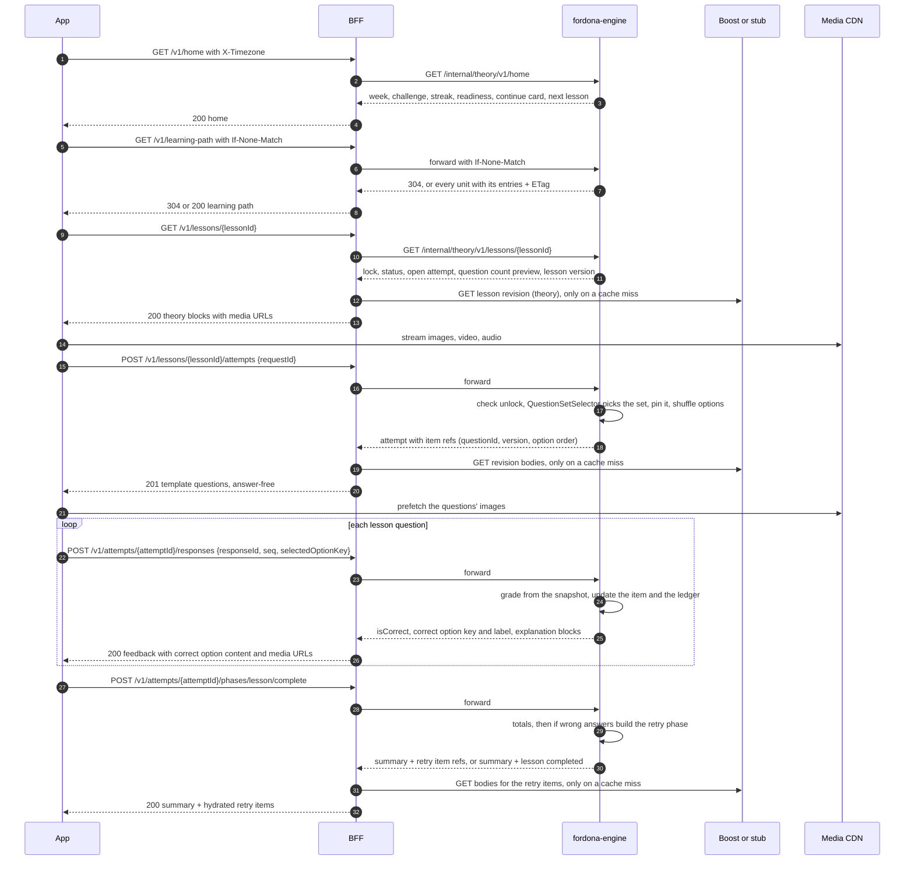

### 7.2 Retry phase

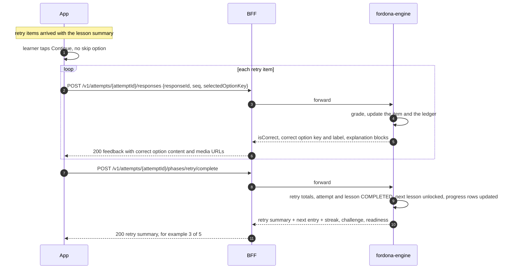

### 7.3 Public contracts (App ↔ BFF)

**The complete public surface for this release.** Every endpoint is answered with **one** engine call; Boost is
called only on a BFF cache miss, and then in batches.

| Method and path | Screen | Engine calls | Boost, only on a cache miss |
|---|---|---|---|
| `GET /v1/home` | Home dashboard | 1 | — |
| `GET /v1/learning-path` | Swipe-up sheet | 1 (304 after one primary-key read) | — |
| `GET /v1/readiness` | Readiness detail (the "Readiness >" card) | 1 | — |
| `GET /v1/lessons/{lessonId}` | Lesson theory | 1 | 1 lesson revision |
| `POST /v1/lessons/{lessonId}/attempts` | Start Quiz / Continue | 1 | 1 batch of question revisions |
| `GET /v1/attempts/{attemptId}` | Resume after a restart | 1 | 1 batch |
| `POST /v1/attempts/{attemptId}/responses` | Check Answer | 1 | — (bodies already cached) |
| `POST /v1/attempts/{attemptId}/phases/lesson/complete` | Lesson summary, then the retry phase | 1 | 1 batch for the retry items |
| `POST /v1/attempts/{attemptId}/phases/retry/complete` | Retry summary | 1 | — |

**Common request headers:**
- `Authorization: Bearer <Kinde token>` (Fordona audience);
- `Accept-Language: sv-SE | en-GB`;
- `X-Timezone: <IANA zone>`, e.g. `Europe/Stockholm`;
- optional `X-Request-Id`.

**Common response rules:**
- Bodies are unwrapped JSON.
- Errors are RFC 7807 with `errorCode` and `correlationId`.
- Every response carries `X-Correlation-Id`.

**Retired at release:** the BFF's current catalogue routes `/v1/modules*`, `/v1/lessons/{id}/questions` and
`/v1/questions*`. They expose the whole question bank without entitlement or sequencing checks (R-11).
`/v1/lessons/{lessonId}` keeps its path with the new meaning below.

**`GET /v1/home`** → 200 (the whole dashboard in one call)
```json
{ "user": { "initials": "SI", "firstName": "Samira" },
  "week": { "timezone": "Europe/Stockholm", "startsOn": "SUNDAY",
            "days": [ { "date": "2026-11-01", "status": "done" },
                      { "date": "2026-11-02", "status": "today", "done": false },
                      { "date": "2026-11-03", "status": "upcoming" } ] },
  "dailyChallenge": { "type": "COMPLETE_LESSONS", "target": 3, "progress": 1, "completed": false,
                      "resetsAt": "2026-11-02T23:00:00Z" },
  "streak": { "current": 5, "longest": 9, "extendedToday": false },
  "readiness": { "percent": 13 },
  "tabs": { "learningPath": { "locked": false }, "mockExams": { "locked": true, "lockReason": "NOT_AVAILABLE" } },
  "continue": { "kind": "lesson", "unitId": "1", "unitDisplayIndex": "1", "lessonId": "11", "displayIndex": "1.1",
                "title": "Introduction to Driving", "action": "START", "openAttempt": null },
  "upNext": [ { "kind": "lesson", "lessonId": "12", "displayIndex": "1.2", "title": "Introduction to Signs",
                "status": "locked" } ],
  "learningPathEtag": "\"42.17.a9f3.sv-SE\"" }
```
- `week.days` always has 7 entries (shortened here); the app renders the weekday letters for its locale.
- **`continue.action`:**
  - `CONTINUE`: a lesson with an open attempt (most recently touched first);
  - `START`: otherwise, the next unlocked lesson not yet completed;
  - `UPGRADE`: the next lesson is in a unit the learner isn't entitled to. The app shows **Upgrade to Continue**.

  `continue` is `null` when every lesson is completed.
- **Tapping the card** opens `GET /v1/lessons/{lessonId}`; the theory screen's button then starts or continues the
  attempt.
- **`learningPathEtag`:** if it equals the ETag of the sheet the app already holds, the app shows its cached sheet
  with no request at all.
- **Mock exams** are out of scope for this release, so that tab is always locked (`NOT_AVAILABLE`).
- **Partial failure:** if the progress rows can't be read, `week`, `dailyChallenge`, `streak` and `readiness` are
  `null` and the rest still renders. The continue card never depends on them.

**`GET /v1/learning-path`** → 200 with `ETag`, or **304** for a matching `If-None-Match` (the swipe-up sheet)
```json
{ "units": [
    { "unitId": "1", "displayIndex": "1", "title": "Fundamentals", "iconUrl": null,
      "locked": false, "lockReason": null,
      "progress": { "completedLessons": 3, "totalLessons": 7, "percent": 43 },
      "entries": [
        { "kind": "lesson", "lessonId": "11", "displayIndex": "1.1", "title": "Introduction to Driving",
          "status": "completed", "lastResult": { "correct": 6, "total": 8 }, "openAttempt": null },
        { "kind": "lesson", "lessonId": "14", "displayIndex": "1.4", "title": "Road Signs",
          "status": "current", "lastResult": null, "openAttempt": null },
        { "kind": "lesson", "lessonId": "15", "displayIndex": "1.5", "title": "Driving on Ice",
          "status": "locked", "lastResult": null, "openAttempt": null } ] },
    { "unitId": "2", "displayIndex": "2", "title": "Switches & Buttons", "iconUrl": null,
      "locked": true, "lockReason": "SUBSCRIPTION",
      "progress": { "completedLessons": 0, "totalLessons": 6, "percent": 0 },
      "entries": [ { "kind": "lesson", "lessonId": "21", "displayIndex": "2.1", "title": "Polished Something",
                     "status": "locked", "lastResult": null, "openAttempt": null } ] } ] }
```
- **Entry `status`:** `completed | current | locked`. With sequential unlocking there is exactly **one** `current`
  entry in the whole path (the design's **Go** row), the same lesson as home's continue card. A completed lesson
  being retaken keeps `completed` and shows its `openAttempt`.
- **`entries`, not `lessons`, and every entry has a `kind`.** Only `lesson` exists in this release.
- **Client rule, required now:** the app **must skip entries whose `kind` it does not know.** This lets the future
  "Repeat…" entry ship from the backend without breaking installed app versions.
- `displayIndex` is computed by the engine; the app never computes it and keys on ids.
- **Size:** about 150 lessons is ~25 KB of JSON, ~5 KB gzipped. Response headers:
  `Cache-Control: private, no-cache` and `ETag`.
- No question count on entries; the lesson theory screen shows it (below).

**`GET /v1/readiness`** → 200 (the readiness detail screen)
```json
{ "percent": 13, "completedLessons": 3, "totalLessons": 23, "averageBestAccuracy": 0.81,
  "units": [ { "unitId": "1", "displayIndex": "1", "title": "Fundamentals", "percent": 35,
               "completedLessons": 3, "totalLessons": 7, "locked": false } ] }
```
Formula in §5.7. Per-unit values use the same formula restricted to the unit.

**`GET /v1/lessons/{lessonId}`** → 200 (the theory screen, before **Start Quiz**)
```json
{ "lessonId": "14", "displayIndex": "1.4", "title": "Sign Language", "status": "available",
  "estimatedMinutes": 8, "questionCount": 8,
  "openAttempt": null,
  "theory": [
    { "type": "text", "markdown": "Welcome to Lesson 1.4: Sign Language. In this lesson you'll explore …" },
    { "type": "image", "url": "https://media.fordona…/a/77/960.webp?sig=…", "srcset": [ "…480", "…1440" ],
      "alt": "Give-way sign", "width": 960, "height": 540 },
    { "type": "video", "hlsUrl": "https://media.fordona…/v/81/master.m3u8?sig=…",
      "posterUrl": "https://…", "durationSec": 94,
      "captions": [ { "locale": "sv-SE", "url": "https://…/sv.vtt" } ] },
    { "type": "audio", "hlsUrl": "https://…/a/90/master.m3u8?sig=…", "durationSec": 420, "transcript": "…" },
    { "type": "animation", "format": "lottie", "url": "https://…/l/12.json", "alt": "…" },
    { "type": "rule_card", "kind": "RULE", "title": "Right-Hand Right of Way",
      "points": [ "Vehicles (including bicycles) coming from the right have the right of way." ] } ] }
```
- **Composition:** the engine supplies lock, status, open attempt, `questionCount` and `lessonVersion`. The BFF adds
  the theory blocks from Boost (cached by revision) and resolves every asset to a URL.
- **`questionCount` is a preview:** `QuestionSetSelector` is pure, so the engine runs it for the attempt that
  **Start Quiz** would create, without creating anything. The attempt response's count is authoritative if content
  changed in between.
- **`estimatedMinutes`:** the lesson's `estimatedReadMinutes` from Boost when set. Otherwise it is computed as reading time
  + media durations + 45 s per question.
- **Locked lessons:** 403 `THEORY_LESSON_LOCKED` or `THEORY_MODULE_LOCKED`. The BFF fetches no theory for them, so
  paid content never leaves the server.
- **With an open attempt:** `openAttempt` is `{ attemptId, phase }`, and the app shows **Continue** instead of
  **Start Quiz**.

**`POST /v1/lessons/{lessonId}/attempts`** with `{ "requestId": "uuid" }` → **201**, or **200** for a replay or a
resumed open attempt
```json
{ "attemptId": "uuid", "lessonId": "12", "displayIndex": "1.2", "status": "IN_LESSON",
  "questionCount": 8,
  "items": [ { "seq": 1, "phase": "LESSON", "type": "mcq",
               "prompt": [ { "type": "text", "markdown": "You are driving out of a supermarket car park …" },
                           { "type": "image", "url": "https://…", "alt": "…", "width": 960, "height": 540 } ],
               "options": [ { "key": "a", "label": "A",
                              "content": [ { "type": "text", "markdown": "Vehicles coming from your right." } ] } ],
               "answered": null } ],
  "retry": null }
```
- The BFF builds `prompt` and `options` (content blocks, assets resolved to URLs) from the Boost revision, ordered as
  the engine's `optionOrder` says. An option may be text, an image (e.g. a sign), or both.
- Items carry **no** question id, revision, level or source, so the client can't tell repeat items from similar ones.
- **No template id in the public contract.** A future personalized set may span several templates, so the app must
  never depend on "an attempt = a template". The app gets the question count and the questions; which template they
  came from stays server-side.
- On a resume:
  - `answered` holds the same feedback object as the response endpoint below, for answered items;
  - `retry` holds the retry items when `status` is `IN_RETRY`.

**`GET /v1/attempts/{attemptId}`** → 200, the same shape (resume after the app restarts).

**`POST /v1/attempts/{attemptId}/responses`** with
`{ "responseId": "uuid", "seq": 3, "selectedOptionKey": "b", "durationMs": 8400 }` → 200
```json
{ "seq": 3, "isCorrect": false, "selectedOptionKey": "b",
  "correctOption": { "key": "c", "label": "C",
                     "content": [ { "type": "text", "markdown": "Every vehicle whose path crosses yours." } ] },
  "explanation": [
    { "type": "text", "markdown": "In this instance the right-hand rule applies …" },
    { "type": "rule_card", "kind": "RULE", "title": "Right-Hand Right of Way",
      "points": [ "Vehicles (including bicycles) coming from the right have the right of way." ] } ] }
```
- The engine returns the key, the label (it stored the option order) and the explanation blocks. The BFF adds
  `correctOption.content` from the body it served and resolves asset URLs.
- The app writes "So the right answer is C, …" from `correctOption`. That sentence is never authored, so it can't
  contradict the highlighted option.

**`POST /v1/attempts/{attemptId}/phases/lesson/complete`** (no body) → 200
```json
{ "attemptId": "uuid", "status": "IN_RETRY",
  "lessonSummary": { "total": 8, "correct": 6, "wrong": 2 },
  "retry": { "total": 5, "items": [ { "seq": 9, "phase": "RETRY", "type": "mcq",
                                      "prompt": [ "…blocks" ], "options": [ "…" ], "answered": null } ] },
  "next": null, "progress": null }
```
With no wrong answers: `"status": "COMPLETED"`, `"retry": null`, and `next` and `progress` set as below.

**`POST /v1/attempts/{attemptId}/phases/retry/complete`** (no body) → 200
```json
{ "attemptId": "uuid", "status": "COMPLETED",
  "retrySummary": { "total": 5, "correct": 3, "wrong": 2 },
  "next": { "kind": "lesson", "lessonId": "13", "displayIndex": "1.3", "title": "Road Signs", "status": "current",
            "action": "START" },
  "progress": { "streak": { "current": 6, "longest": 9, "extendedToday": true },
                "dailyChallenge": { "target": 3, "progress": 2, "completed": false },
                "readiness": { "percent": 17 }, "learningPathEtag": "\"42.18.a9f3.sv-SE\"" } }
```
- `next` is the new continue target, with the same `action` values as home (`START`, or `UPGRADE` at the end of the
  last entitled unit). It is `null` when everything is completed.
- `progress` lets the app update the streak, challenge and readiness, and know that its cached learning path is
  stale, without calling home again.

| Status | errorCode | When |
|---|---|---|
| 403 | `THEORY_MODULE_LOCKED` | Unit not entitled (existing rule) |
| 403 | `THEORY_LESSON_LOCKED` | Previous lesson not completed |
| 404 | `THEORY_LESSON_NOT_FOUND`, `THEORY_ATTEMPT_NOT_FOUND` | Unknown id, or another learner's attempt (404, not 403) |
| 404 | `THEORY_ITEM_NOT_FOUND` | `seq` not in this attempt |
| 409 | `THEORY_REQUEST_ID_CONFLICT` | `requestId` reused for a different lesson |
| 409 | `THEORY_RESPONSE_CONFLICT` | Item already answered with a different option, or `responseId` reused |
| 409 | `THEORY_PHASE_CLOSED` | Answering an item outside the current phase |
| 409 | `THEORY_PHASE_INCOMPLETE` | Completing a phase with unanswered items |
| 422 | `THEORY_OPTION_INVALID` | Option key not in this question |
| 503 | `UPSTREAM_UNAVAILABLE` (BFF) | Boost unreachable **and** a body or theory is not in the cache |

Every engine code gets keys in `messages.properties` and `messages_sv.properties`.

### 7.4 Internal contracts (BFF ↔ engine)

- **Paths:** the same as §7.3, under `/internal/theory/v1/…`. Responses are wrapped in `Payload<T>`, and the BFF
  unwraps them.
- **Item refs:** each carries `{ seq, phase, questionId, version, optionOrder: ["c","a","d","b"], answered? }`.
  - **No text and no key.** Feedback fields appear only after an answer.
  - The BFF replaces each ref with the hydrated item and drops `questionId` and `version`.
- **Feedback:** `{ isCorrect, selectedOptionKey, correctOptionKey, correctOptionLabel, explanation: [blocks] }`. The
  explanation blocks carry asset ids, and the BFF resolves them.
- **Lesson state:** `GET /internal/theory/v1/lessons/{lessonId}` returns
  `{ status, locked, lockReason, openAttempt, questionCount, estimatedMinutes, lessonVersion }`.
  The BFF never decides access itself: it fetches theory only when the engine says the lesson is not locked.
- **Home, learning path, readiness:**
  - The engine returns the complete public body, titles included, since it holds unit and lesson titles in its
    snapshot. The BFF adds only resolved icon URLs.
  - For the learning path, the BFF forwards `If-None-Match` unchanged and relays the engine's `304` or `ETag`.
- **Forwarded headers:** `Accept-Language`, `X-Timezone` and the correlation id are forwarded on every call.
- **Credentials:** the learner's JWT is forwarded, plus `X-Fordona-Internal-Token` (PA DD-04). The engine derives the
  learner from the JWT, never from a body field.
- **BFF timeouts:**
  - 2 s for reads and answers;
  - 5 s for phase completion;
  - 1.5 s per Boost call. A cache miss uses **one batch call** (§13), not one call per question.
- **Connection pooling:** HTTP/1.1 keep-alive pools to the engine and to Boost, sized with the engine's Hikari pool,
  so no request pays a TCP or TLS handshake.

### 7.5 Engine ↔ Boost (or the stub)

| Call | Credential | When |
|---|---|---|
| `GET /v1/delivery/changes?after={cursor}` (§13.3) | Engine delivery token | Every 30 s. An empty page means nothing to do. |
| Lists by id (`modules`, `lessons`, `question-templates`, `questions`) for the changed ids | Engine delivery token | Only for ids in the change page |
| `GET /v1/grading/questions/revisions?refs=…` (batch, ≤ 100) | Grading token (engine only) | Once per new question revision |
| Full lists (`pageSize` 250) | Engine delivery token | Only on a full resync (`content-sync?full=true`) |

**If Boost is down:** grading uses stored keys, and bodies come from the BFF cache. Lessons keep working except for
a question whose body was never cached.

### 7.6 Platform endpoints (platform admin)

| Endpoint | Purpose |
|---|---|
| `POST /v1/platform/theory/content-sync?full=false\|true` | Sync now. `full=true` resets the cursor and re-reads everything (after a source switch). |
| `GET /v1/platform/theory/content-report` | Release, hidden templates and lessons, excluded questions, similarity coverage, extras shortfall |
| `GET /v1/platform/theory/retry-policy`, `PUT …/{scope}/{scopeId}` | Read and edit the retry policy |

---

## 8. Similarity extension point

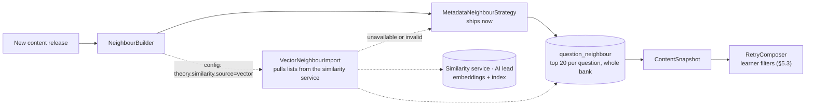

**The split:**
- *Content-only similarity* ("which questions in the bank resemble this one") is computed **once per release**.
- *Learner filters* (level, entitlement, reached lessons, seen before) run at request time over that list, in memory.

**Metadata strategy (now).** Candidates come from the **whole bank**, ranked by:

| Rank group | Score |
|---|---|
| Same lesson (other templates), same topic | 1.0 |
| Same unit, same topic | 0.8 |
| Same lesson, same domain | 0.6 |
| Same topic anywhere in the bank | 0.5 |
| Same domain, same unit | 0.4 |

Inside a group, rank by closest difficulty, then by `questionId` for determinism. Keep the top 20, which is enough
for the filters to still leave candidates.

**Vector strategy (later).** The contract is fixed now, so the AI lead can build against it:
```jsonc
// GET {similarity-service}/v1/neighbours?releaseId=42   (the engine pulls after each release)
{ "releaseId": 42, "model": "emb-2026-11",
  "neighbours": [ { "questionId": "815", "version": "7",
                    "candidates": [ { "questionId": "1022", "version": "2", "score": 0.87 } ] } ] }
```
- **The service owns the vectors.** It reads published content from Boost's delivery API (or the stub), embeds the
  text of `(questionId, version, locale)`, and keeps its own vector index. The engine stores **no vectors**.
- **The engine validates every list before accepting it:**
  - ids exist;
  - versions are current;
  - the question isn't excluded.

  Invalid entries are dropped. If the whole pull fails, the metadata lists stay.
- **The engine always applies its own rules (§5.3)** to whatever list is stored. A provider can never leak a paid
  unit, spoil a lesson the learner hasn't reached, or break the level rule.

**Stored now, so nothing is reworked later:**

| Data | Where | Later use |
|---|---|---|
| Boost `questionId` + immutable `version` | `content_question_revision` | Joining similarity output to content; stale versions rejected |
| `domain_code`, `topic_tag`, `difficulty`, `level` | Revision row + snapshot on every item | Comparing vector against metadata |
| `item_source`, `origin_question_id`, `provider`, `similarity_score` | `attempt_item` | Offline evaluation: does the similar item's result predict later success on the seed? |
| Every answer with phase and correctness | `attempt_item` | Training and validation labels |

**Swap procedure:** deploy the import, then set `theory.similarity.source=vector` for one unit. Compare
`retry_correct` and later retake results by `provider`. No schema or API change.

---

## 9. Performance and scale

### 9.1 Hot paths

| Call | Content reads | Database work | Target p99 at the BFF |
|---|---|---|---|
| `GET /home` | Engine snapshot; entitlement cache | Summary PK read, ≤ 7 activity rows, 1 `lesson_progress` range scan | 80 ms |
| `GET /learning-path` | Engine snapshot | 304: 1 PK read. 200: + 1 `lesson_progress` range scan | 30 ms (304) / 80 ms (200) |
| `GET /readiness` | Engine snapshot | Summary PK read + 1 range scan | 60 ms |
| `GET /lessons/{id}` (theory) | Engine snapshot; BFF Redis for theory blocks | 1 indexed read of the learner's prior attempts on the lesson (selector preview) | 100 ms warm |
| Start attempt | Engine snapshot; BFF Redis (Boost only on a miss) | Insert 1 attempt + n items in one batch, upsert `lesson_progress` | 150 ms warm |
| Answer | Engine snapshot (grading in memory) | 1 PK read with share lock, 1 conditional update, 1 ledger upsert | 60 ms |
| Complete lesson phase | Snapshot + neighbour lists; BFF Redis | Lock attempt, aggregate n items, 1 "seen before" query, insert W + E items | 180 ms warm |
| Complete retry phase (lesson completed) | Snapshot | Lock attempt, aggregate, update attempt and `lesson_progress`, 1 activity insert + day upsert, 1 summary update | 120 ms |

**These targets cover the JSON only; media is outside them** (§9.5).

**Warm means the bodies and theory are in Redis.** They are immutable per revision, so after the first learner
reads a question or a theory it is never fetched again. Signing media URLs happens per response and costs
microseconds (an HMAC per asset). To make even the first read warm, the BFF can prefetch the bodies of every
question in a new release. The sync's release id is exposed to the BFF for this.

### 9.2 Engine content snapshot

- **What it is:** one immutable in-memory object per instance, holding:
  - structure and templates;
  - revision metadata and keys;
  - neighbour lists;
  - the retry policy.

  It is swapped atomically when a new one is built.
- **Multi-instance refresh:** every instance reads `max(release_id)` every 30 s and rebuilds when it changes. There is
  no webhook that only one replica would receive.
- **Older pinned revisions** (no longer current) load on demand into a bounded Caffeine cache. They are immutable, so
  they need no expiry.
- **Size:** without text, the snapshot is a few MB even at thousands of questions. A rebuild takes well under a
  second.

### 9.3 Capacity

- **Load estimate:** 10k concurrent learners at one answer every 15 s each gives:
  - **~670 answers/s**, at ~2 writes per answer, so ~1.4k row writes/s;
  - ~85 phase completions/s.

  A single properly sized Postgres primary handles this.
- **Locks are always per learner.** There is no unit-level or global row on the write path.
- **The BFF and the engine are stateless** and scale out horizontally. Size the BFF→engine pool and Hikari together.
- **Redis holds only immutable bodies.** Losing it costs a warm-up, not correctness.
- **No read replicas on the hot path:** an answer must be visible to the next phase completion.

### 9.4 Levers, only when measured

| Signal | Lever |
|---|---|
| `attempt_item` past ~100M rows, or vacuum lag | Monthly partitioning by attempt start, with the partition key in the item PK |
| Ledger upsert latency | Move the ledger write after commit; it is not on the learner's critical path |
| Cold-cache spikes after a publish | Turn on release prefetch in the BFF (§9.1) |

### 9.5 Media delivery

Media is almost all of the bytes a learner downloads, so it gets its own rules:

| Concern | Rule |
|---|---|
| Path | **App → CDN directly.** The BFF and the engine never carry media bytes; their capacity is independent of how much video Eric adds. |
| Images | Responsive variants (e.g. 480/960/1440 px) in WebP/AVIF. The app picks by screen width. Immutable, so cached for a year at the CDN and on the device. |
| GIFs | Converted at ingest to a muted looping MP4/WebM (`animation`, `video_loop`). A raw GIF is never delivered. |
| Animations | Lottie JSON where the author can produce it (vector, a few KB); otherwise `video_loop` |
| Video | HLS with an adaptive bitrate ladder (e.g. 360p/720p/1080p), so playback starts fast on mobile networks and adapts. Poster frame shown first. No autoplay with sound. |
| Audio / podcasts | HLS or AAC, streamed with range requests; never downloaded whole before playing |
| Prefetch | While the learner reads the theory, the app prefetches the **images** of the quiz questions (the attempt response arrives on Start Quiz; for the first question the app can prefetch right after). Video and audio are streamed on demand only. |
| Payload budget | The JSON for an attempt stays small (target < 50 KB) because blocks carry URLs, not media |
| Signed URLs | TTL 2 h covers a long lesson; an expired URL returns 403 from the CDN, and the app re-fetches the lesson or attempt to get fresh ones |
| Data saver (app setting) | The app may request the lower image variant and cap the HLS bitrate; no backend change |

---

## 10. Full system design

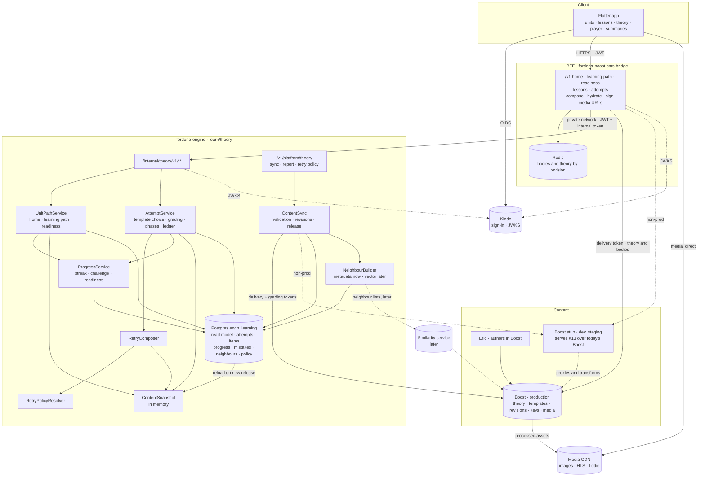

---

## 11. Ready for later: the "Repeat…" entry and personalized sets

Removed from this release. What this design already does so it can be added later as an **engine-only** change:

| Already in place | Why it matters later |
|---|---|
| `GET /v1/learning-path` returns typed `entries`, and the app is **required to skip unknown kinds** | A `kind: "review"` entry can appear without an app release. Older apps simply don't show it. |
| `displayIndex` is computed by the engine; the app keys on ids | Inserting an entry (and renumbering) needs no client logic |
| `lesson_attempt.kind` (`LESSON` now) | A review attempt reuses the attempt, item, phase, grading and feedback machinery unchanged |
| The retry composer takes **seeds**, not "the wrong items of this lesson" | A review is "seeds = the learner's open mistakes in the unit", with the same similarity, filters and caps |
| The mistake ledger with `status`, `times_wrong`, `last_wrong_at`, `resolved_via`, from day one | The trigger (fixed slot or threshold) has full history without a backfill |
| `retry_policy` scopes and attempt snapshots | Review limits become new policy keys, with no new mechanism |

**What the future change adds:**
- a `review` entry kind and its attempt `kind = REVIEW`;
- the trigger rule:
  - an authored slot after lesson k;
  - and/or the threshold `T = clamp(round(p × questions in the unit), Tmin, Tmax)`, as designed in revision 1;
- the policy keys for it.

### 11.1 Ready for personalized question sets

Templates are the raw material for personalized sets in a later release. This release only prepares for them:

| Already in place | Why it matters later |
|---|---|
| `QuestionSetSelector` port; `fixed-v1` is the only implementation | A personalized selector is a new implementation plus a config switch, not a change to attempts, grading or the API |
| The selector returns a **list of question refs**, not a template id | A personalized set can mix questions across templates and lessons |
| The public API exposes no template id | Installed apps keep working when an attempt no longer equals one template |
| First attempts spread evenly across templates by hash | Unbiased difficulty and error data per question and per template, the input a personalization design needs |
| `selection_strategy` / `selection_reason` on every attempt; `template_id` + topic, domain, difficulty, level, correctness and duration on every item | Strategies can be compared on the same metrics, and models trained on clean history |

**Not decided now, on purpose:** what personalization optimises, which signals it reads, and whether it uses rules
or the AI lead's models. Those need the first release's data.

**Not built now, for either feature:** no review table, no personalization code, no flag-guarded code paths. Unused
code rots; the recorded data and the contract shape are what make the later changes cheap.

---

## 12. Risks and open decisions

|  #  | Item | Recommendation | Owner |
|---|---|---|---|
| **O-1** | **Boost must implement the §13 contract**: templates, `topicKey`, content blocks, the change feed and batch reads. Eric can't author templates until it exists. | This is the **critical path**. Hand §13 to the Boost owner now. The stub serves §13 from day one, so our side isn't blocked, and the contract test suite is the acceptance test for Boost's implementation. | Boost owner |
| **R-1** | **The repeat items measure short-term recall.** The app shows the correct answer after each question, and the same question returns minutes later. | Ship as designed. Re-shuffle options, mix repeats with similar items, and record `resolved_via = REPEAT` so no future logic treats it as mastery. The **similar** items are the real signal. For product to weigh: show only correct/incorrect during the lesson phase and reveal answers after the retry phase. | Product + seniors |
| **O-2** | **Which template a first attempt uses**, now that templates are meant for later personalization | **Hash-spread** across templates (§5.2): non-personalized, stable per learner, and it yields comparable data on every template. The alternative, "template 1 for everyone", is simpler to support ("everyone sees the same 8 questions") but leaves the other templates almost without data. Either is one `QuestionSetSelector` rule. | Product + seniors |
| **R-7** | **Hash-spread means learners compare different questions.** Two friends can see different first questions in lesson 1.2, and support can't assume one fixed set. | Accept: the attempt records exactly which questions were served, so support and analytics always know. **Templates within a lesson must be authored to equal difficulty** (Eric's guideline), otherwise the first release is unfair between learners. The content report shows the difficulty mix per template so this can be checked. | Content |
| **O-3** | **Similar questions from the whole bank can leak paid content.** A free learner's mistake in unit 1 could otherwise pull a question from a locked unit. | The entitlement filter (§5.3 d) is **mandatory, not configurable**. | Seniors |
| **O-4** | Sequential unlocking of lessons | Adopt. Without it, "forced" can be bypassed by opening another lesson. | Product |
| **O-5** | Whole bank vs spoilers: should a lesson-1.2 mistake ever pull a question from lesson 3.4? | Default `similar_scope = REACHED` (the current and completed lessons). `ALL` matches the brief literally and is one config change. | Product |
| **O-6** | 8 of 8 correct: is there still a retry phase? | **No** (W = 0). The 2–5 extras are tied to wrong answers. | Product |
| **O-7** | Large W: 10 wrong of 10 gives 15 retry questions | Accept: the brief says every wrong question returns. If product wants a ceiling, add `max_retry_items`; repeats are kept first, extras shrink. | Product |
| **O-8** | "1.8 Test End of Unit" | A standard lesson with its own templates and retry phase. Exam behaviour is out of scope. | Product |
| **R-2** | Similar items from the same lesson's other templates are then seen again when a retake rotates to that template | Accepted: a retake is practice, and the "unseen first" filter already prefers questions not yet answered. | Product |
| **R-3** | The stub drifts from the real Boost API | Contract tests in CI run the BFF's and the engine's Boost clients against the stub **and** against Boost's published OpenAPI. Staging switches to real Boost as soon as Eric's first templates are published. | Backend |
| **R-4** | Cold body cache right after a publish: the first learners per question wait on Boost | Bounded by the 1.5 s fetch timeout and parallel fetches. Release prefetch (§9.1) removes it if it shows in p99. | Backend |
| **R-5** | Wrong answer keys published in Boost reach every learner on the next sync | Boost's review step is the control. Fixing it in Boost publishes a new revision; answers already graded are not re-graded, and the report flags revisions whose key changed. | Content |
| **R-6** | True/false questions are 50% guessable | Accepted for this release; `type` is on every item, so analysis can discount it. | Seniors |
| **O-9** | Must the learner finish the theory (e.g. watch the video) before **Start Quiz**? | **No.** Start Quiz is always available. Forcing playback needs client-side progress tracking that is easy to fake, and it frustrates returning learners on retakes. If product wants it later, it is an app rule plus engagement events, with no backend contract change. | Product |
| **O-10** | **Who processes and hosts media.** Does Boost handle video/audio upload, transcoding to HLS, GIF conversion, image variants, captions and a signed-URL CDN? | Ask the Boost owner first. If Boost only stores files, use **Cloudflare R2 + Cloudflare Stream** (R2 is already in our stack), with Boost holding the asset ids. The block format and the BFF's URL resolution don't change either way, only the resolver's target. | Boost owner + supervisor |
| **R-8** | **Paid media leaking via permanent URLs** | Signed, short-lived URLs for non-free units (§4.6), signed per response so caches never hold a signed URL. The BFF doesn't serve theory for locked lessons at all. | Backend |
| **R-9** | **Media questions take longer and may be harder**, which skews `duration_ms` and difficulty across templates | Record per question whether it has video or audio (from the sync's revision metadata) so analysis can separate them. Authors keep video prompts short (≤ 60 s recommended). | Content + analytics |
| **R-10** | **CDN egress cost of video** grows with learners × minutes watched | Adaptive HLS ladders cap the bytes. Measure egress per active learner in the first month before adding long theory videos at scale. | Ops |
| **R-11** | **The BFF's current catalogue routes leak the bank.** `/v1/lessons/{id}/questions` and `/v1/questions*` return every question of a lesson, with no entitlement or sequencing check. | Remove them from the public surface before the mobile release (§7.3). If the web app still uses them, move it first or restrict them to the web app's audience. | Backend |
| **O-11** | Progress definitions: does a retake count as activity; daily-challenge target 3 distinct lessons; week starts Sunday (as in the design) or Monday (Swedish convention) | Adopt the §5.7 definitions. All three are config, not code. | Product |
| **O-12** | **Readiness formula.** §5.7 replaces the engine's existing readiness (which weighted a best mock exam). Mock exams are out of this release. | Adopt §5.7 for theory, and expose readiness as one number plus components so a mock-exam component can be added later. Make sure the web app doesn't show a second, different readiness. | Product |
| **R-12** | **Change-feed holes.** If two Boost publish transactions commit out of sequence order, a reader can skip a change for good. | §13.3 requires the feed never to expose a `seq` while a lower one may still commit (a 5-second visibility lag is enough). The engine also runs a nightly full resync as a safety net. | Boost owner |
| **R-13** | The stub's HTML → blocks conversion is lossy for unusual HTML in today's lessons | Only for dev and staging, and it logs what it dropped. Boost's native `blocks` (§13) removes it. | Backend |
| **R-14** | Changing the device timezone could extend a streak by a day | Accepted: the gain is at most one day per change and needs deliberate effort. Activity is keyed by local date, so nothing is double-counted. | Product |

---

## 13. Boost content API contract (for the Boost owner)

This section is written so it can be handed to the Boost owner as is. The Fordona stub (§4.5) implements it today;
Boost implements it natively, and the shared contract test suite decides when Boost is done.

### 13.1 Principles

- **Additive only.** Every existing `/v1` endpoint and field keeps working, so current consumers are unaffected.
- **Boost's existing conventions:**
  - string decimal ids;
  - an immutable `version` per published revision;
  - the `locale` query parameter;
  - list pages `{ items, total, page, pageSize, asOf }` with `pageSize ≤ 250`;
  - items `{ id, version, locale, shared, translation, resources, assetBaseUrl }`;
  - errors `{ status, code, detail, requestId, errors }`.
- **Two token scopes, unchanged:** the **delivery** token reads `/v1/delivery/**` and never sees answers; the
  **grading** token reads `/v1/grading/**`.
- **Published content only.** Drafts never appear on these endpoints.

### 13.2 Endpoints

| # | Endpoint | Purpose | Token |
|---|---|---|---|
| 1 | `GET /v1/delivery/changes?after={cursor}&limit={1–1000, default 500}` | Change feed (§13.3) | Delivery |
| 2 | `GET /v1/delivery/question-templates?lessonId=&moduleId=&id=&page=&pageSize=&locale=` | List templates | Delivery |
| 3 | `GET /v1/delivery/question-templates/{id}/revisions/{version}?locale=` | One immutable template revision | Delivery |
| 4 | `GET /v1/delivery/lessons/{id}/revisions/{version}?locale=` | One immutable lesson revision, i.e. the theory (**new**) | Delivery |
| 5 | `GET /v1/delivery/questions/revisions?refs={id}:{version},…&locale=` | Batch of up to 100 question revisions (**new**) | Delivery |
| 6 | `GET /v1/grading/questions/revisions?refs={id}:{version},…` | Batch of up to 100 grading revisions, all locales (**new**) | Grading |
| 7 | `GET /v1/delivery/topics?moduleId=` | Topic vocabulary of a module (**new**) | Delivery |
| — | Existing lists (`modules`, `lessons`, `questions`) | Accept a multi-value `id=1,2,3` filter (up to 100), so a consumer can fetch exactly the ids a change page names | Delivery |

**Batch endpoints (5, 6):**
- They return `200` with `{ "items": [ … ], "missing": [ "817:2" ] }`. Refs that don't exist or aren't published go
  in `missing`; they never fail the whole call.
- More than 100 refs returns `422`.

### 13.3 Change feed

```json
{ "items": [
    { "seq": "184467", "entityType": "QUESTION", "id": "815", "version": "8",
      "change": "PUBLISHED", "publishedAt": "2026-11-02T09:14:03Z" },
    { "seq": "184468", "entityType": "QUESTION_TEMPLATE", "id": "301", "version": "3",
      "change": "UNPUBLISHED", "publishedAt": "2026-11-02T09:14:05Z" } ],
  "nextCursor": "184468", "hasMore": false }
```
- **`entityType`:** `MODULE | LESSON | QUESTION_TEMPLATE | QUESTION | TOPIC`.
- **`change`:** `PUBLISHED` (new or new version) or `UNPUBLISHED`.
- **Write path:** Boost writes one change row **in the same transaction as the publish**.
- **Read query:** `WHERE seq > :after ORDER BY seq LIMIT :limit` on the primary key. An idle poll is one index probe.
- **Commit-order safety (required):** the feed must never return a `seq` while a lower `seq` may still commit.
  Otherwise a consumer moves its cursor past a change it will never see. The simplest correct implementation returns
  only rows created more than 5 seconds ago.
- **Delivery semantics:** at least once. Consumers treat a repeated item as a no-op.
- **Retention:** at least 30 days. A cursor older than that returns `410` with `code: CURSOR_EXPIRED`, and the
  consumer runs a full resync.

### 13.4 Resource shapes (additions only)

**Question template**
```json
{ "id": "301", "version": "3", "locale": "sv-SE",
  "shared": { "lessonId": "14", "moduleId": "1", "sort": 1,
              "questions": [ { "questionId": "815", "sort": 1 }, { "questionId": "816", "sort": 2 } ] },
  "translation": { "title": "Sign Language · A" } }
```

Rules Boost enforces at publish:
- a template has ≥ 3 questions, all in the same module;
- every question it references is published;
- a question used by a published template can't be unpublished until it is removed from that template;
- any change to membership or order creates a new template `version`.

**Question** (new fields; `questionText` and `options[].text` stay for existing consumers)
```json
{ "id": "815", "version": "7", "locale": "sv-SE",
  "shared": { "lessonId": "14", "moduleId": "1", "subjectId": "3", "difficulty": 3, "type": "mcq",
              "topicKey": "right-of-way.right-hand-rule" },
  "translation": {
    "prompt": [ { "type": "text", "markdown": "You are driving out of a supermarket car park …" },
                { "type": "image", "assetId": "a77", "alt": "Car park exit", "width": 1440, "height": 810 } ],
    "options": [ { "id": "o1", "blocks": [ { "type": "text", "markdown": "Vehicles coming from your right." } ] },
                 { "id": "o3", "blocks": [ { "type": "image", "assetId": "a91", "alt": "Give-way sign" } ] } ] },
  "assetBaseUrl": "https://…" }
```

**Grading revision** (batch item, all locales)
```json
{ "id": "815", "version": "7", "correctOptionId": "o3",
  "explanation": { "sv-SE": [ { "type": "text", "markdown": "…" } ],
                   "en-GB": [ { "type": "text", "markdown": "In this instance the right-hand rule applies …" },
                              { "type": "rule_card", "kind": "RULE", "title": "Right-Hand Right of Way",
                                "points": [ "Vehicles (including bicycles) coming from the right have the right of way." ] } ] } }
```

**Lesson** (new field): `translation.blocks` holds the theory. `shared.estimatedReadMinutes` already exists.

**Topic:** `{ "key": "right-of-way.right-hand-rule", "moduleId": "1", "title": { "sv-SE": "…", "en-GB": "…" } }`.

**Content blocks and assets:**
- Exactly the block types and rules in §4.6.
- `assetId` is a published file id. The asset record carries:
  - `type`: `image | animation | video | audio`;
  - `alt`, `durationSec`, `posterFileId`;
  - `captions: [{ locale, fileId }]` and `transcript`;
  - a processing status. Content can't be published until processing is finished.

### 13.5 Non-functional requirements

| Requirement | Target |
|---|---|
| Revision endpoints (3, 4, 5, and the existing single question revision) | `Cache-Control: public, max-age=31536000, immutable` and an `ETag` |
| List endpoints | `ETag`; `If-None-Match` returns `304` |
| Latency at Boost, p99 | ≤ 100 ms for a single revision; ≤ 250 ms for a batch of 100; ≤ 50 ms for an empty change page |
| Compression | gzip or brotli on every JSON response |
| Expected load from Fordona | Engine: one feed poll per 30 s per environment, plus batch reads only for changed content. BFF: batch reads only on cache misses, which are near zero at steady state because revisions are immutable. |
| Availability | Fordona lessons keep working through a Boost outage (cached bodies, stored keys); only newly published content waits. Boost is not on the per-answer path. |

### 13.6 Acceptance

- The contract test suite in the BFF repo (`tests/contract/boost_content_v1/`) covers every endpoint, rule and error
  above.
- Boost's implementation is accepted when the suite passes against Boost staging, the same suite that passes
  against the stub.

---

## 14. Build list and hand-off

### 14.1 Work per repository

| Where | Work |
|---|---|
| **fordona-engine** | `learn/theory` package; Flyway `V1_0_16+` (content read model, attempts, items, progress, summary, activity, ledger, neighbours, policy); ContentSync over the §13 change feed and batch grading; in-memory snapshot; `QuestionSetSelector` (`fixed-v1`); attempts and grading; retry composer; neighbour builder; ProgressService (§5.7); internal API for every §7.3 endpoint (home, learning path with ETag, readiness, lesson state, attempts); platform endpoints; error codes with `messages` + `messages_sv` keys |
| **fordona-boost-cms-bridge** | The §7.3 public surface; engine client (keep-alive pool, header forwarding, ETag pass-through); question and theory hydration via §13 batch reads with a Redis cache by revision; asset id → (signed) CDN URL; `BOOST_AUTH_MODE=service_token` and the shared Fordona audience; per-user rate limits; retiring the old catalogue routes; OpenAPI generated at `/openapi.json` |
| **Boost stub** (BFF repo, `src/boost_stub/`) | §13 facade (§4.5); template generator; `synthetic.json`; Docker target; contract test suite |
| **Boost owner** | §13 |
| **Mobile app** | Screens per §2; block renderer and players; client rules in §14.3 |
| **Ops** | Dokploy apps: engine, BFF (+ its Postgres and Redis), stub (dev and staging only); private network between them; Kinde audience; CDN and media (O-10) |

### 14.2 Definition of done for our side (staging, against the stub)

- **Endpoints:** every §7.3 endpoint is live in staging and documented in the BFF's OpenAPI. A Postman collection
  walks the whole journey (home → learning path → theory → start → answers → lesson complete → retry answers → retry
  complete → home), with pre-request scripts for `requestId` / `responseId`.
- **Contract tests:** green against the stub.
- **Concurrency tests (Testcontainers):** a double start gives one attempt; a double answer is a replay or a 409; a
  double phase-complete returns the same summary; two devices completing at once are serialised; a streak is counted
  once per local day.
- **Load test (k6):** 670 answers/s with mixed home, learning-path and theory traffic, p99 within §9.1, measured at
  the BFF.
- **Observability:** OpenTelemetry traces from the BFF to the engine, a dashboard for p99 per endpoint, Boost
  cache-hit rate, sync lag (feed cursor age) and error rate by `errorCode`.
- **Runbook:** content sync, full resync, the stub → Boost swap, and resetting a test learner.

### 14.3 Hand-off package for the mobile developer

| Item | Content |
|---|---|
| API | Staging base URL, the OpenAPI document, the Postman collection, the error-code table (§7.3) |
| Auth | Kinde app settings (PKCE, Fordona audience) and the integration guide |
| Test accounts | One free learner (Unit 1 only) and one entitled learner |
| QA answer sheet | Staging only: correct options for the stub's templates, so testers can answer wrong on purpose and see the retry phase |
| **Client rules** | Send `X-Timezone` and `Accept-Language` on every call · key on ids, never `displayIndex` · skip unknown entry `kind`s and block `type`s · generate a new `requestId` per start tap and `responseId` per answer, and reuse them on retry · cache the learning path with its ETag and compare with home's `learningPathEtag` · resume via `openAttempt` / `GET /v1/attempts/{id}` · no skip in the retry phase · build the "right answer is C" sentence from `correctOption` · on a CDN 403, re-fetch the lesson or attempt to get fresh media URLs · stream video and audio, prefetch only images |

### 14.4 What still blocks a production release (outside our side)

1. Boost implements §13 and passes the contract suite (O-1).
2. Eric's content is authored and published in Boost.
3. Media processing and CDN are decided and live (O-10).
4. Kinde issues one Fordona audience accepted by the BFF and the engine.
5. The old catalogue routes are retired (R-11).
6. Product signs off O-2, O-4, O-9, O-11 and O-12.

---

## 15. Retiring the BFF's current catalogue routes (R-11)

These routes exist today in `fordona-boost-cms-bridge` (`api/routes/questions.py`, `lessons.py`, `modules.py`):
- `GET /v1/questions`, `GET /v1/questions/{questionId}`, `GET /v1/questions/{questionId}/revisions/{version}`;
- `GET /v1/lessons/{lessonId}/questions`;
- `GET /v1/modules`, `GET /v1/modules/{moduleId}`, `GET /v1/modules/{moduleId}/lessons`.

They return answer-free content, but they check only that the caller is signed in: there is no entitlement or
sequencing check.

**What to do:**
- **Before the BFF goes live, delete `/v1/questions*` and `/v1/lessons/{id}/questions`.** The new design never needs
  them: questions reach the app only inside an attempt, chosen and checked by the engine.
- **`/v1/modules*` isn't a leak** (catalogue only), but `GET /v1/learning-path` replaces it. Remove it too, so the
  mobile developer doesn't build against two catalogue APIs.
- **`GET /v1/lessons/{lessonId}` keeps its path but changes meaning:** it becomes the theory screen, checked against
  the engine's lock.
- **Check the web app first.** If any client already calls these routes, give it a migration path before removing
  them.
